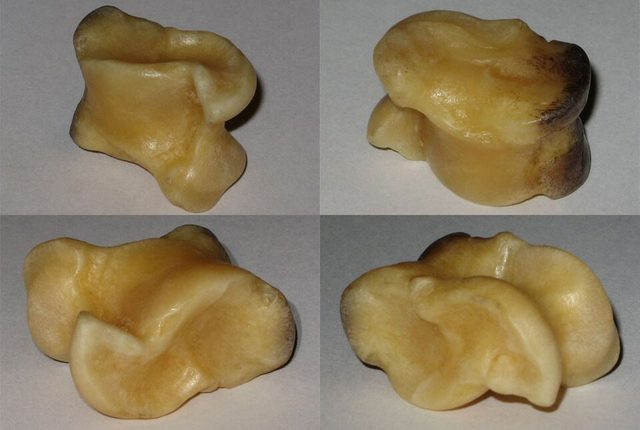

# Knucklebone game

*Also known as: Bujal Bazi · Shagai (anklebone games) · Knucklebones*

**Encyclopedia ID 522** (permanent) · https://bpupadhyaya.github.io/world-heritage-games-site/games/522-knucklebone-game/

*Photo: User:Yaan, [CC BY-SA 3.0](https://creativecommons.org/licenses/by-sa/3.0/), [source on Wikimedia Commons](https://commons.wikimedia.org/wiki/File:Shagai_2x2.jpg)*

Sheep anklebones with four sides (horse, sheep, camel, goat) are used as dice and tokens in many games, including tabletop flick races over about ten metres.

## Heritage note

Part of the living heritage of Mongolia.

## Origins

Usually placed in the era of Deep Past and First Games (before about 3000 BCE), although its exact origins are uncertain, within the cultural world of Persia, Caucasus and Central Asia.

## Facts

- **Where:** Afghanistan, Mongolia
- **Type:** Dexterity and skill games
- **Family:** Dice and knucklebone games
- **Era:** [Deep Past and First Games](../../eras/deep-past/index.md) (uncertain)
- **Cradle:** [Persia, Caucasus and Central Asia](../../cradles/persia-central-asia/index.md)
- **Region:** South and Central Asia
- **Players:** 2+

## Play it

[Web preview](https://bpupadhyaya.github.io/games-site/games/shagai-anklebone-flicks/play/) · [Google Play](https://play.google.com/store/apps/details?id=com.equalinformation.arcforge.shell) · [App Store](https://apps.apple.com/us/app/arcforge-world-heritage-games/id6813746442)

## Related entries

- [Besh Tash](../../games/869-besh-tash/index.md)
- [Gonggi](../../games/1085-gonggi/index.md)
- [Taba](../../games/594-taba/index.md)
- [Jacks](../../games/697-jacks/index.md)
- [Jacks, Dandy Shandy, ring games](../../games/842-jacks-dandy-shandy-ring-games/index.md)
- [Five stones](../../games/907-five-stones/index.md)

## Sources

- <https://en.wikipedia.org/wiki/Traditional_games_of_Afghanistan>
- <https://en.wikipedia.org/wiki/Shagai>
- <https://www.discovermongolia.mn/about-mongolia/culture-art-history/mongolian-toys-and-games>
