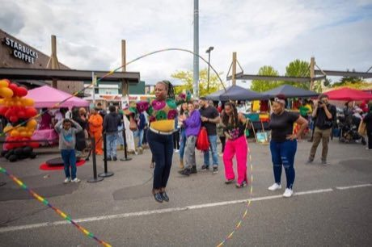

# Double Dutch

**Encyclopedia ID 53** (permanent) · https://bpupadhyaya.github.io/world-heritage-games-site/games/53-double-dutch/

*Photo: Double Dutch Divas, [CC BY-SA 4.0](https://creativecommons.org/licenses/by-sa/4.0/), [source on Wikimedia Commons](https://commons.wikimedia.org/wiki/File:Youth_and_community_members_have_fun_playing_Double_Dutch!.jpg)*

Jump between two ropes turned in opposite directions, adding tricks and rhymes as speed rises.

## Heritage note

Part of the living heritage of United States.

## Origins

Usually placed in the era of Modern Heritage (1800 to today), although its exact origins are uncertain, within the cultural world of The Americas: North America.

## Facts

- **Where:** United States
- **Type:** Street and playground games
- **Family:** Rhyme and hand games
- **Era:** [Modern Heritage](../../eras/modern/index.md) (uncertain)
- **Cradle:** [The Americas: North America](../../cradles/north-america/index.md)
- **Region:** Americas

## Play it

[Web preview](https://bpupadhyaya.github.io/) · [Google Play](https://play.google.com/store/apps/details?id=com.equalinformation.arcforge.shell) · [App Store](https://apps.apple.com/us/app/arcforge-world-heritage-games/id6813746442)

## Related entries

- [Elastic Jump](../../games/6-elastic-jump/index.md)
- [Cublak-cublak suweng](../../games/325-cublak-cublak-suweng/index.md)
- [Dikir barat](../../games/1268-dikir-barat/index.md)
- [Woggabaliri](../../games/561-woggabaliri/index.md)
- [Finger pulling](../../games/563-finger-pulling/index.md)
- [Kriol traditional games](../../games/585-kriol-traditional-games/index.md)

## Sources

- <https://commons.wikimedia.org/wiki/File:Youth_and_community_members_have_fun_playing_Double_Dutch!.jpg>
