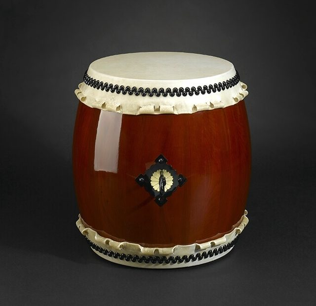

# Taiko

*Also known as: 太鼓 · Japanese drum*

**Encyclopedia ID 5367** (permanent) · https://bpupadhyaya.github.io/world-heritage-games-site/games/5367-taiko/

*Photo: Taiko-Kaiser-Drums, [CC BY-SA 3.0](https://creativecommons.org/licenses/by-sa/3.0/), [source on Wikimedia Commons](https://commons.wikimedia.org/wiki/File:Miya_Daiko_drum_-_Taiko_drums.jpg)*

A family of Japanese drums played in ensembles with large barrel drums and a kinetic stage style.

## How it is played

Performers strike drums of different sizes with thick sticks in coordinated rhythms.

## Heritage note

Part of the living heritage of Japan.

## Origins

A living tradition passed from person to person; it is not tied to a single dated origin. It belongs to the cultural world of Japan and Korea.

## Facts

- **Where:** Japan
- **Type:** Musical instruments
- **Family:** Drums and percussion
- **Era:** [Living Traditions](../../eras/living/index.md)
- **Cradle:** [Japan and Korea](../../cradles/japan-korea/index.md)
- **Region:** East and Southeast Asia
- **Players:** team

## Play it

[Web preview](https://bpupadhyaya.github.io/games-site/games/taiko-drum-circle/) · [Google Play](https://play.google.com/store/apps/details?id=com.equalinformation.arcforge.shell) · [App Store](https://apps.apple.com/us/app/arcforge-world-heritage-games/id6813746442)

## Related entries

- [Talking drum](../../games/33-talking-drum/index.md)
- [Tabla Bol Rhythm](../../games/35-tabla-bol-rhythm/index.md)
- [Marimba](../../games/52-marimba/index.md)
- [Calabash Water Drum](../../games/180-calabash-water-drum/index.md)
- [Amadinda and embaire](../../games/185-amadinda-and-embaire/index.md)
- [Isukuti drum dance](../../games/191-isukuti-drum-dance/index.md)

## Sources

- <https://en.wikipedia.org/wiki/Taiko>
