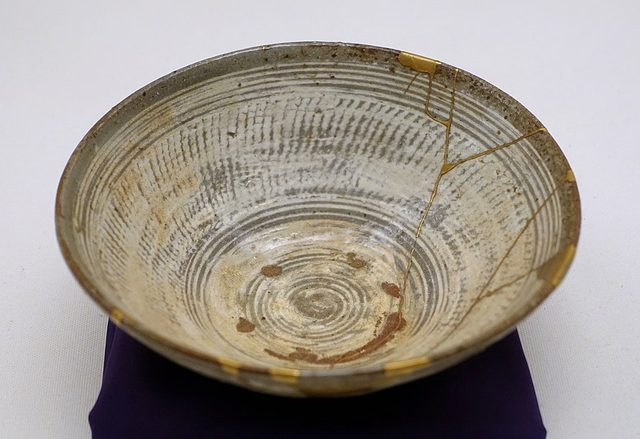

# Kintsugi

*Also known as: 金継ぎ*

**Encyclopedia ID 5371** (permanent) · https://bpupadhyaya.github.io/world-heritage-games-site/games/5371-kintsugi/

*Photo: Daderot, [CC0](https://creativecommons.org/publicdomain/zero/1.0/), [source on Wikimedia Commons](https://commons.wikimedia.org/wiki/File:Tea_bowl,_Korea,_Joseon_dynasty,_16th_century_AD,_Mishima-hakeme_type,_buncheong_ware,_stoneware_with_white_engobe_and_translucent,_greenish-gray_glaze,_gold_lacquer_-_Ethnological_Museum,_Berlin_-_DSC02061.JPG)*

The craft of repairing broken ceramics with lacquer dusted with gold or other metallic powder.

## How it is played

Fragments are joined with lacquer, cured over time and finished with metallic powder along the seam.

## Heritage note

Part of the living heritage of Japan.

## Origins

A living tradition passed from person to person; it is not tied to a single dated origin. It belongs to the cultural world of Japan and Korea.

## Facts

- **Where:** Japan
- **Type:** Crafts and making
- **Family:** Pottery, wood and metal crafts
- **Era:** [Living Traditions](../../eras/living/index.md)
- **Cradle:** [Japan and Korea](../../cradles/japan-korea/index.md)
- **Region:** East and Southeast Asia
- **Players:** solo

## Play it

[Try a 90-second preview in your browser](https://bpupadhyaya.github.io/games-site/games/kintsugi-gold-seams/play/) · [Google Play](https://play.google.com/store/apps/details?id=com.equalinformation.arcforge.shell) · [App Store](https://apps.apple.com/us/app/arcforge-world-heritage-games/id6813746442)

## Related entries

- [Lost-Wax Bronze Casting](../../games/178-lost-wax-bronze-casting/index.md)
- [Leaded Glass Window Making](../../games/501-leaded-glass-window-making/index.md)
- [Ukiyo-e Woodblock Printing](../../games/1490-ukiyo-e-woodblock-printing/index.md)
- [Goryeo Celadon Inlay](../../games/1455-goryeo-celadon-inlay/index.md)
- [Zellij tile mosaic](../../games/21-zellij-tile-mosaic/index.md)
- [Swahili carved door](../../games/90-swahili-carved-door/index.md)

## Sources

- <https://en.wikipedia.org/wiki/Kintsugi>
