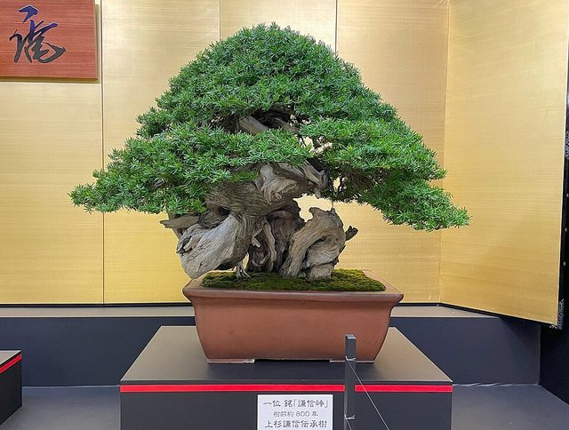

# Bonsai

*Also known as: 盆栽*

**Encyclopedia ID 5376** (permanent) · https://bpupadhyaya.github.io/world-heritage-games-site/games/5376-bonsai/

*Photo: Order of the Rose (薔薇騎士団), [CC BY 4.0](https://creativecommons.org/licenses/by/4.0/), [source on Wikimedia Commons](https://commons.wikimedia.org/wiki/File:Bonsai,_Kenshin_Toge.jpg)*

The art of cultivating and shaping miniature trees in shallow containers.

## How it is played

Growers prune roots and branches, wire limbs and shape trees over years to imitate ancient natural forms.

## Heritage note

Part of the living heritage of Japan.

## Origins

A living tradition passed from person to person; it is not tied to a single dated origin. It belongs to the cultural world of Japan and Korea.

## Facts

- **Where:** Japan
- **Type:** Crafts and making
- **Era:** [Living Traditions](../../eras/living/index.md)
- **Cradle:** [Japan and Korea](../../cradles/japan-korea/index.md)
- **Region:** East and Southeast Asia
- **Players:** solo

## Play it

[Web preview](https://bpupadhyaya.github.io/games-site/games/bonsai-prune-and-shape/) · [Google Play](https://play.google.com/store/apps/details?id=com.equalinformation.arcforge.shell) · [App Store](https://apps.apple.com/us/app/arcforge-world-heritage-games/id6813746442)

## Related entries

- [Sashiko Stitch Patterns](../../games/27-sashiko-stitch-patterns/index.md)
- [Karesansui](../../games/95-karesansui/index.md)
- [Temari Thread-Ball Patterns](../../games/96-temari-thread-ball-patterns/index.md)
- [Kumiko lattice](../../games/97-kumiko-lattice/index.md)
- [Ikebana](../../games/98-ikebana/index.md)
- [Shibori Indigo Fold](../../games/106-shibori-indigo-fold/index.md)

## Sources

- <https://en.wikipedia.org/wiki/Bonsai>
