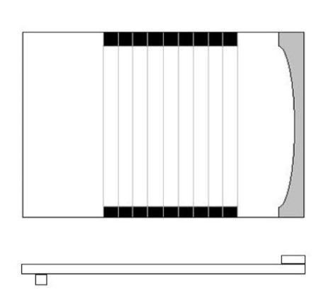

# Shove ha'penny

**Encyclopedia ID 54** (permanent) · https://bpupadhyaya.github.io/world-heritage-games-site/games/54-shove-hapenny/

*Photo: unknown (Commons), [Public domain](https://creativecommons.org/publicdomain/mark/1.0/), [source on Wikimedia Commons](https://commons.wikimedia.org/wiki/File:Shove_ha_penny.JPG)*

Slide five coins with the heel of the hand across a lined board to rest within nine beds; claim each bed three times.

## Heritage note

Part of the living heritage of United Kingdom.

## Origins

Usually placed in the era of Modern Heritage (1800 to today), although its exact origins are uncertain, within the cultural world of Celtic and Atlantic Europe.

## Facts

- **Where:** United Kingdom
- **Type:** Dexterity and skill games
- **Family:** Puzzle and dexterity toys
- **Era:** [Modern Heritage](../../eras/modern/index.md) (uncertain)
- **Cradle:** [Celtic and Atlantic Europe](../../cradles/celtic-atlantic/index.md)
- **Region:** Europe

## Related entries

- [Disc-flip](../../games/8-disc-flip/index.md)
- [Cynghanedd Poetry Puzzle](../../games/1448-cynghanedd-poetry-puzzle/index.md)
- [Sjoelen](../../games/9-sjoelen/index.md)
- [Pitch and toss](../../games/822-pitch-and-toss/index.md)
- [Kingyo-sukui](../../games/3-kingyo-sukui/index.md)
- [Stone Skipping](../../games/5-stone-skipping/index.md)

## Sources

- <https://commons.wikimedia.org/wiki/File:Shove_ha_penny.JPG>
