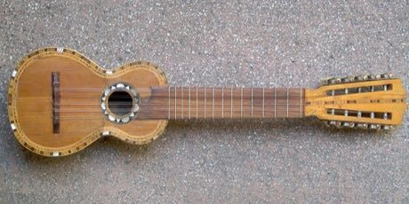

# Charango

*Charango*

**Encyclopedia ID 55** (permanent) · https://equalinformation.com/world-heritage-games-site/games/55-charango/

*Photo: Villanueva, [Public domain](https://creativecommons.org/publicdomain/mark/1.0/), [source on Wikimedia Commons](https://commons.wikimedia.org/wiki/File:Bolivian_charango_001.jpg)*

Strum and fret the ten-string small lute through guided songs and patterns.

## Heritage note

Part of the living heritage of Bolivia, Peru. Some forms of this practice carry deep meaning for the communities who keep it; here we describe the play and the craft only, with respect for its roots.

## Origins

Usually placed in the era of Crossroads and Golden Ages (about 500 to 1500), although its exact origins are uncertain, within the cultural world of The Americas: Andes and South America.

## Facts

- **Where:** Bolivia, Peru
- **Type:** Musical instruments
- **Family:** String instruments
- **Era:** [Crossroads and Golden Ages](../../eras/crossroads/index.md) (uncertain)
- **Cradle:** [The Americas: Andes and South America](../../cradles/andes-south-america/index.md)
- **Region:** Americas

## Related entries

- [Dombra](../../games/48-dombra/index.md)
- [Erhu Two-String Fiddle](../../games/139-erhu-two-string-fiddle/index.md)
- [Buzuq Long-Neck Lute](../../games/218-buzuq-long-neck-lute/index.md)
- [Komuz](../../games/242-komuz/index.md)
- [Saz / Bağlama](../../games/243-saz-baglama/index.md)
- [Tar and mugham modes](../../games/247-tar-and-mugham-modes/index.md)

## Sources

- <https://commons.wikimedia.org/wiki/File:Bolivian_charango_001.jpg>
