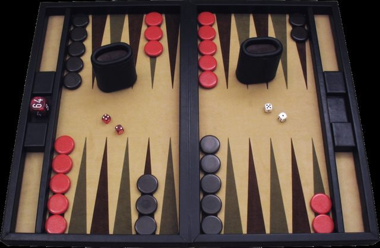

# Nardi

*Also known as: backgammon*

**Encyclopedia ID 551** (permanent) · https://bpupadhyaya.github.io/world-heritage-games-site/games/551-nardi/

*Photo: Ptkfgs, [Public domain](https://creativecommons.org/publicdomain/mark/1.0/), [source on Wikimedia Commons](https://commons.wikimedia.org/wiki/File:Backgammon_lg.png)*

Persian dice-race tables game; Iranians say it is the leading board game in tea houses and homes.

## Heritage note

Part of the living heritage of Armenia, Azerbaijan, Georgia.

## Origins

Usually placed in the era of River Valleys and First Cities (about 3000 to 1000 BCE), although its exact origins are uncertain, within the cultural world of Persia, Caucasus and Central Asia.

## Facts

- **Where:** Armenia, Azerbaijan, Georgia, Iran
- **Type:** Board and table games
- **Family:** Race and cross games
- **Era:** [River Valleys and First Cities](../../eras/river-valleys/index.md) (uncertain)
- **Cradle:** [Persia, Caucasus and Central Asia](../../cradles/persia-central-asia/index.md)
- **Region:** Europe
- **Players:** 2

## Play it

[Web preview](https://bpupadhyaya.github.io/games-site/games/tavla-dice-and-points/) · [Google Play](https://play.google.com/store/apps/details?id=com.equalinformation.arcforge.shell) · [App Store](https://apps.apple.com/us/app/arcforge-world-heritage-games/id6813746442)

## Related entries

- [Nard / backgammon](../../games/1168-nard-backgammon/index.md)
- [Nard / long backgammon](../../games/1205-nard-long-backgammon/index.md)
- [Tavli](../../games/656-tavli/index.md)
- [Senet](../../games/693-senet/index.md)
- [Don't Get Angry](../../games/744-dont-get-angry/index.md)
- [Ludo](../../games/763-ludo/index.md)

## Sources

- <https://armenianvendor.com/popular-board-games-in-armenia/>
- <https://en.wikipedia.org/wiki/Nard_(game)>
- <https://en.wikipedia.org/wiki/Chovgan>
- <https://www.onelowerlight.com/writing/life-in-georgia-is-like-a-game-of-backgammon/>
