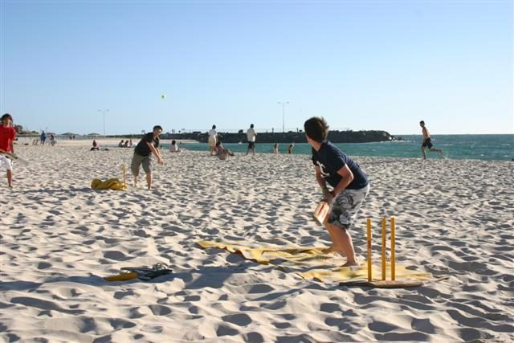

# Backyard cricket

**Encyclopedia ID 559** (permanent) · https://bpupadhyaya.github.io/world-heritage-games-site/games/559-backyard-cricket/

*Photo: laneylou, [CC BY 2.0](https://creativecommons.org/licenses/by/2.0/), [source on Wikimedia Commons](https://commons.wikimedia.org/wiki/File:Beach_cricket.jpg)*

Improvised family and street cricket with house rules such as tip-and-run and one-hand-one-bounce.

## How it is played

Improvised family and street cricket with house rules such as tip-and-run and one-hand-one-bounce. A summer-holiday tradition.

## Heritage note

Part of the living heritage of Australia.

## Origins

Usually placed in the era of Age of Contact and Craft (about 1500 to 1800), although its exact origins are uncertain, within the cultural world of Pacific and Oceania.

## Facts

- **Where:** Australia
- **Type:** Street and playground games
- **Family:** Bat-and-ball games
- **Era:** [Age of Contact and Craft](../../eras/contact/index.md) (uncertain)
- **Cradle:** [Pacific and Oceania](../../cradles/pacific/index.md)
- **Region:** Oceania and Pacific
- **Players:** 2-10

## Play it

[Try a 90-second preview in your browser](https://bpupadhyaya.github.io/games-site/games/timing-six-cricket-chase/play/) · [Google Play](https://play.google.com/store/apps/details?id=com.equalinformation.arcforge.shell) · [App Store](https://apps.apple.com/us/app/arcforge-world-heritage-games/id6813746442)

## Related entries

- [Samoan cricket](../../games/1056-samoan-cricket/index.md)
- [Pasifika kirikiti](../../games/980-pasifika-kirikiti/index.md)
- [Tongan cricket](../../games/1149-tongan-cricket/index.md)
- [Tuvaluan kilikiti](../../games/1172-tuvaluan-kilikiti/index.md)
- [Vanuatu cricket](../../games/1209-vanuatu-cricket/index.md)
- [Yard cricket](../../games/1151-yard-cricket/index.md)
