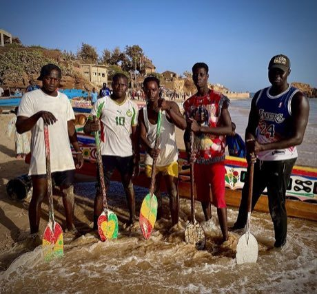

# Pirogue coastal canoe race

*Course de pirogues*

**Encyclopedia ID 56** (permanent) · https://bpupadhyaya.github.io/world-heritage-games-site/games/56-pirogue-coastal-canoe-race/

*Photo: M.GADJ!, [CC BY-SA 4.0](https://creativecommons.org/licenses/by-sa/4.0/), [source on Wikimedia Commons](https://commons.wikimedia.org/wiki/File:Gagnants_de_la_course_de_pirogues_au_Dialaw_Festival.jpg)*

Paddle left and right in rhythm in a painted fishing canoe through surf and waves, balancing the crew to win the race.

## Heritage note

A tradition shared by communities in many places.

## Origins

Usually placed in the era of Age of Contact and Craft (about 1500 to 1800), although its exact origins are uncertain.

## Facts

- **Where:** Shared across many places
- **Type:** Racing
- **Family:** Water sports
- **Era:** [Age of Contact and Craft](../../eras/contact/index.md) (uncertain)
- **Cradle:** [Shared across the world](../../cradles/worldwide/index.md)
- **Region:** Sub-Saharan Africa

## Related entries

- [Nouka Baich](../../games/42-nouka-baich/index.md)
- [Nile Felucca Sailing](../../games/216-nile-felucca-sailing/index.md)
- [Shikara paddle race](../../games/265-shikara-paddle-race/index.md)
- [Hanetsuki](../../games/347-hanetsuki/index.md)
- [Venetian lagoon regatta](../../games/486-venetian-lagoon-regatta/index.md)
- [Ngalawa outrigger sailing](../../games/1259-ngalawa-outrigger-sailing/index.md)

## Sources

- <https://commons.wikimedia.org/wiki/File:Gagnants_de_la_course_de_pirogues_au_Dialaw_Festival.jpg>
