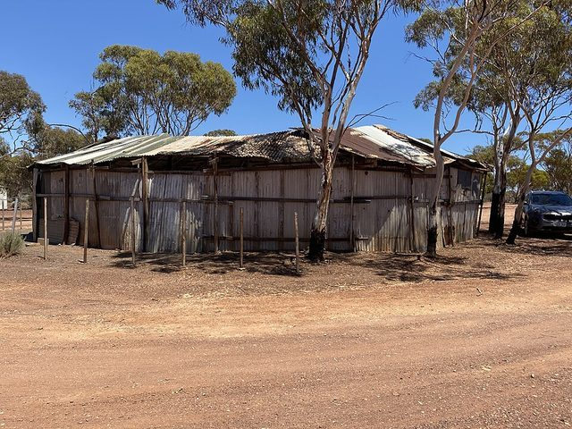

# Two-up

*Also known as: Swy*

**Encyclopedia ID 560** (permanent) · https://bpupadhyaya.github.io/world-heritage-games-site/games/560-two-up/

*Photo: Silverhorse, [CC BY-SA 4.0](https://creativecommons.org/licenses/by-sa/4.0/), [source on Wikimedia Commons](https://commons.wikimedia.org/wiki/File:Kalgoorlie_two_up_shed.jpg)*

A spinner tosses two coins from a flat board; bets are placed on two heads, two tails or odds, and odds means a rethrow.

## How it is played

A spinner tosses two coins from a flat board; bets are placed on two heads, two tails or odds, and odds means a rethrow. Linked to WWI soldiers and Anzac Day.

## Heritage note

Part of the living heritage of Australia.

## Origins

Usually placed in the era of Age of Contact and Craft (about 1500 to 1800), although its exact origins are uncertain, within the cultural world of Pacific and Oceania.

## Facts

- **Where:** Australia
- **Type:** Board and table games
- **Family:** Dice and knucklebone games
- **Era:** [Age of Contact and Craft](../../eras/contact/index.md) (uncertain)
- **Cradle:** [Pacific and Oceania](../../cradles/pacific/index.md)
- **Region:** Oceania and Pacific
- **Players:** Group around a spinner

## Related entries

- [Billycart derby](../../games/445-billycart-derby/index.md)
- [Beach flags](../../games/446-beach-flags/index.md)
- [Backyard cricket](../../games/559-backyard-cricket/index.md)
- ['Ulu Maika](../../games/44-ulu-maika/index.md)
- [Sho](../../games/286-sho/index.md)
- [Liubo](../../games/331-liubo/index.md)

## Sources

- <https://www.abc.net.au/news/2019-04-25/anzac-day-history-of-two-up/11042264>
- <https://rslqld.org/news/two-up-an-anzac-day-tradition>
- <https://en.wikipedia.org/wiki/Two-up>
