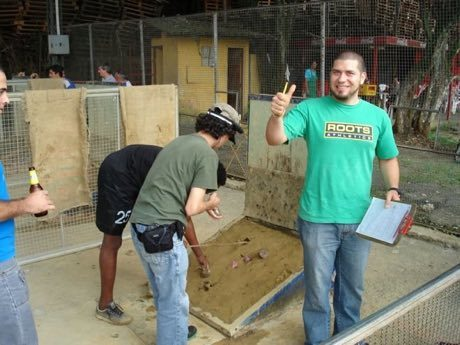

# Tejo

*Tejo / Turmequé · Turmequé*

**Encyclopedia ID 57** (permanent) · https://equalinformation.com/world-heritage-games-site/games/57-tejo/

*Photo: Luis Pérez from Medellin, Colombia, [CC BY 2.0](https://creativecommons.org/licenses/by/2.0/), [source on Wikimedia Commons](https://commons.wikimedia.org/wiki/File:Juego_de_tejo_en_Envigado.jpg)*

Toss a heavy metal disc across a short lane into a clay-filled box to land it in a ring, and score extra when it pops the little paper-wrapped charges set on the ring.

## Heritage note

Part of the living heritage of Colombia.

## Origins

Usually placed in the era of Modern Heritage (1800 to today), although its exact origins are uncertain, within the cultural world of The Americas: Andes and South America.

## Facts

- **Where:** Colombia
- **Type:** Archery, throwing and target games
- **Family:** Archery and target games
- **Era:** [Modern Heritage](../../eras/modern/index.md) (uncertain)
- **Cradle:** [The Americas: Andes and South America](../../cradles/andes-south-america/index.md)
- **Region:** Americas

## Related entries

- [Chilean Rayuela](../../games/1427-chilean-rayuela/index.md)
- [Pitch-pot](../../games/2-pitch-pot/index.md)
- [Jukskei](../../games/11-jukskei/index.md)
- [Lagori](../../games/14-lagori/index.md)
- [Bocce](../../games/830-bocce/index.md)
- [Petanque](../../games/872-petanque/index.md)

## Sources

- <https://commons.wikimedia.org/wiki/File:Juego_de_tejo_en_Envigado.jpg>
