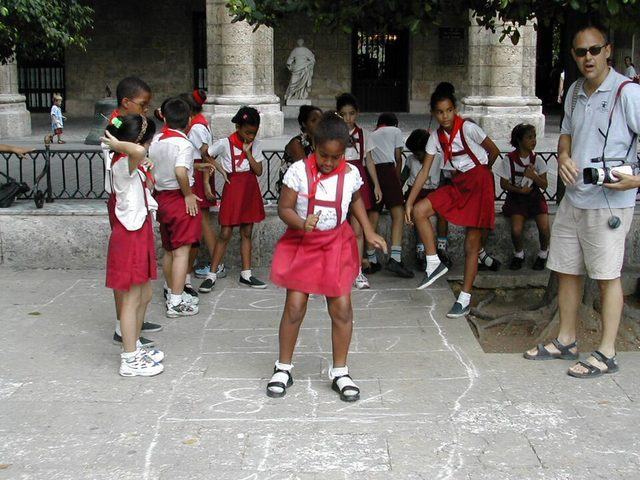

# Street games

*Also known as: Marbles · Hopscotch*

**Encyclopedia ID 570** (permanent) · https://bpupadhyaya.github.io/world-heritage-games-site/games/570-street-games/

*Photo: James Emery from Douglasville, United States, [CC BY 2.0](https://creativecommons.org/licenses/by/2.0/), [source on Wikimedia Commons](https://commons.wikimedia.org/wiki/File:Hopscotch_de_Cubanese.jpg)*

Children's yard games: flicking marbles at targets and hopping through a chalk grid.

## Heritage note

Part of the living heritage of Bahamas.

## Origins

Usually placed in the era of Deep Past and First Games (before about 3000 BCE), although its exact origins are uncertain, within the cultural world of The Americas: Caribbean.

## Facts

- **Where:** Bahamas
- **Type:** Dexterity and skill games
- **Family:** Puzzle and dexterity toys
- **Era:** [Deep Past and First Games](../../eras/deep-past/index.md) (uncertain)
- **Cradle:** [The Americas: Caribbean](../../cradles/caribbean/index.md)
- **Region:** Americas
- **Players:** 1+

## Related entries

- [Hopscotch](../../games/762-hopscotch/index.md)
- [Street](../../games/1052-street/index.md)
- [Pebbles](../../games/874-pebbles/index.md)
- [Diketo](../../games/1076-diketo/index.md)
- [Nhodo](../../games/1346-nhodo/index.md)
- [Seed throwing](../../games/612-seed-throwing/index.md)

## Sources

- <https://www.jamrockmuseum.com/heritage/games-of-jamaica-from-street-corners-to-national-pride/>
