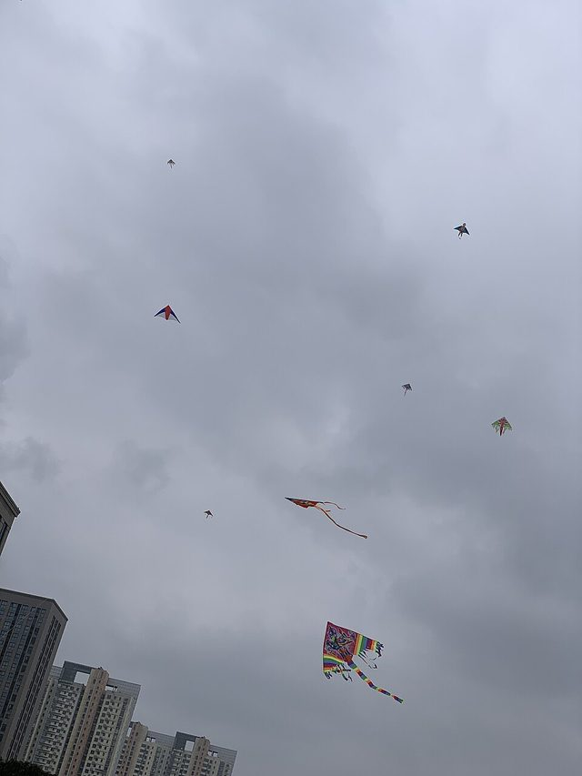

# Kites

*Also known as: Kite flying*

**Encyclopedia ID 577** (permanent) · https://bpupadhyaya.github.io/world-heritage-games-site/games/577-kites/

*Photo: Slyronit, [CC BY-SA 4.0](https://creativecommons.org/licenses/by-sa/4.0/), [source on Wikimedia Commons](https://commons.wikimedia.org/wiki/File:Kites_in_the_sky,_Changzhou.jpg)*

Paper kites on a cane frame, flown in summer and in October.

## Heritage note

Part of the living heritage of Barbados, El Salvador.

## Origins

Usually placed in the era of Classical Worlds (about 1000 BCE to 500 CE), although its exact origins are uncertain, within the cultural world of The Americas: Caribbean.

## Facts

- **Where:** Barbados, El Salvador
- **Type:** Dexterity and skill games
- **Family:** Tops, kites and spinning toys
- **Era:** [Classical Worlds](../../eras/classical/index.md) (uncertain)
- **Cradle:** [The Americas: Caribbean](../../cradles/caribbean/index.md)
- **Region:** Americas
- **Players:** 1+

## Related entries

- [Kitendawili](../../games/181-kitendawili/index.md)
- [Kite flying](../../games/769-kite-flying/index.md)
- [Wau bulan kite](../../games/911-wau-bulan-kite/index.md)
- [Kite fighting](../../games/788-kite-fighting/index.md)
- [Spinning top](../../games/678-spinning-top/index.md)
- [Tuk Band](../../games/1438-tuk-band/index.md)

## Sources

- <https://barbados.org/barbados-traditions.htm>
- <https://historico.elsalvador.com/historico/759235/videojuegos-juegos-infantiles-trompo-piscucha-yoyo-chibolas-jacks.html>
