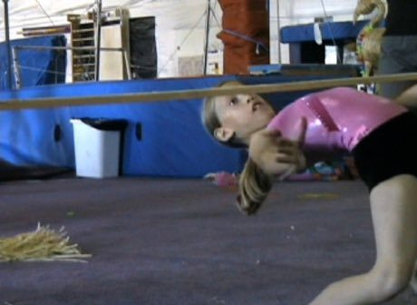

# Limbo

*Limbo*

**Encyclopedia ID 58** (permanent) · https://bpupadhyaya.github.io/world-heritage-games-site/games/58-limbo/

*Photo: Rick McCharles, [CC BY 2.0](https://creativecommons.org/licenses/by/2.0/), [source on Wikimedia Commons](https://commons.wikimedia.org/wiki/File:Limbo_(dance).jpg)*

Lean back and shuffle under a horizontal bar that drops lower each round without touching it or falling.

## Heritage note

Part of the living heritage of Trinidad and Tobago.

## Origins

Usually placed in the era of Modern Heritage (1800 to today), although its exact origins are uncertain, within the cultural world of The Americas: Caribbean.

## Facts

- **Where:** Trinidad and Tobago
- **Type:** Dexterity and skill games
- **Family:** Puzzle and dexterity toys
- **Era:** [Modern Heritage](../../eras/modern/index.md) (uncertain)
- **Cradle:** [The Americas: Caribbean](../../cradles/caribbean/index.md)
- **Region:** Americas

## Related entries

- [Street play games](../../games/1155-street-play-games/index.md)
- [Grenada Nutmeg Grading](../../games/1456-grenada-nutmeg-grading/index.md)
- [Cush](../../games/760-cush/index.md)
- [Kingyo-sukui](../../games/3-kingyo-sukui/index.md)
- [Stone Skipping](../../games/5-stone-skipping/index.md)
- [Disc-flip](../../games/8-disc-flip/index.md)

## Sources

- <https://commons.wikimedia.org/wiki/File:Limbo_(dance).jpg>
