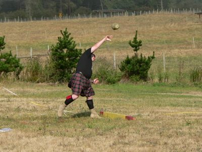

# Stone put

*Also known as: Pundo · Pesa*

**Encyclopedia ID 589** (permanent) · https://bpupadhyaya.github.io/world-heritage-games-site/games/589-stone-put/

*Photo: © James F. Perry, [CC BY-SA 3.0](https://creativecommons.org/licenses/by-sa/3.0/), [source on Wikimedia Commons](https://commons.wikimedia.org/wiki/File:Stone_put_05WDBY_007.jpg)*

A stone over one kilogram is thrown from the shoulder as far as possible, much like shot put.

## Heritage note

Part of the living heritage of Bhutan, Switzerland.

## Origins

Usually placed in the era of Modern Heritage (1800 to today), although its exact origins are uncertain, within the cultural world of South Asia.

## Facts

- **Where:** Bhutan, Switzerland
- **Type:** Dexterity and skill games
- **Family:** Puzzle and dexterity toys
- **Era:** [Modern Heritage](../../eras/modern/index.md) (uncertain)
- **Cradle:** [South Asia](../../cradles/south-asia/index.md)
- **Region:** South and Central Asia
- **Players:** 1+

## Related entries

- [Dego](../../games/590-dego/index.md)
- [Thanjavur dancing doll](../../games/275-thanjavur-dancing-doll/index.md)
- [Chungi](../../games/297-chungi/index.md)
- [Dandi Biyo](../../games/968-dandi-biyo/index.md)
- [Break the pot](../../games/1105-break-the-pot/index.md)
- [Hill-country tea plucking](../../games/1297-hill-country-tea-plucking/index.md)

## Sources

- <https://en.wikipedia.org/wiki/Pundo>
- <https://en.wikipedia.org/wiki/Sports_in_Bhutan>
- <https://en.wikipedia.org/wiki/Steinstossen>
