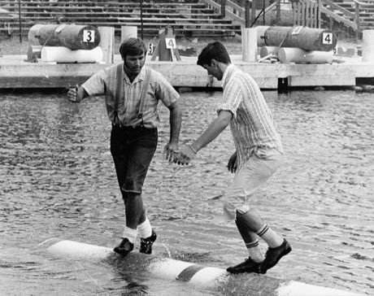

# Log rolling

*Also known as: Birling*

**Encyclopedia ID 59** (permanent) · https://bpupadhyaya.github.io/world-heritage-games-site/games/59-log-rolling/

*Photo: Guywelch2000, [CC BY-SA 4.0](https://creativecommons.org/licenses/by-sa/4.0/), [source on Wikimedia Commons](https://commons.wikimedia.org/wiki/File:Lumberjack_World_Championship_Hayward_Wisconsin_Logrolling.jpg)*

Two players stand on a floating log and spin it with their feet, trying to make the other lose balance and fall in the water.

## Heritage note

Part of the living heritage of United States, Canada. Some forms of this practice carry deep meaning for the communities who keep it; here we describe the play and the craft only, with respect for its roots.

## Origins

Usually placed in the era of Modern Heritage (1800 to today), although its exact origins are uncertain, within the cultural world of The Americas: North America.

## Facts

- **Where:** United States, Canada
- **Type:** Dexterity and skill games
- **Era:** [Modern Heritage](../../eras/modern/index.md) (uncertain)
- **Cradle:** [The Americas: North America](../../cradles/north-america/index.md)
- **Region:** Americas

## Play it

[Web preview](https://bpupadhyaya.github.io/) · [Google Play](https://play.google.com/store/apps/details?id=com.equalinformation.arcforge.shell) · [App Store](https://apps.apple.com/us/app/arcforge-world-heritage-games/id6813746442)

## Related entries

- [Double Dutch](../../games/53-double-dutch/index.md)
- [Square dance caller](../../games/129-square-dance-caller/index.md)
- [Tractor pull](../../games/440-tractor-pull/index.md)
- [Axe throwing](../../games/442-axe-throwing/index.md)
- [Crokinole](../../games/623-crokinole/index.md)
- [Shinny](../../games/725-shinny/index.md)

## Sources

- <https://commons.wikimedia.org/wiki/File:Lumberjack_World_Championship_Hayward_Wisconsin_Logrolling.jpg>
