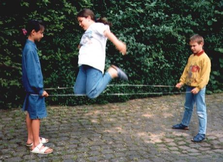

# Elastic Jump

*Also known as: Gummitwist · Tiao pi jin · Chinese Jump Rope*

**Encyclopedia ID 6** (permanent) · https://bpupadhyaya.github.io/world-heritage-games-site/games/6-elastic-jump/

*Photo: Werner, [CC BY-SA 3.0](https://creativecommons.org/licenses/by-sa/3.0/), [source on Wikimedia Commons](https://commons.wikimedia.org/wiki/File:Gummitwist-1998Kinder2.jpg)*

Elastic Jump is a street and playground game tradition from China.

## Heritage note

Part of the living heritage of China.

## Origins

Usually placed in the era of Modern Heritage (1800 to today), although its exact origins are uncertain, within the cultural world of China.

## Facts

- **Where:** China
- **Type:** Street and playground games
- **Family:** Rhyme and hand games
- **Era:** [Modern Heritage](../../eras/modern/index.md) (uncertain)
- **Cradle:** [China](../../cradles/china/index.md)
- **Region:** East and Southeast Asia

## Play it

[Try a 90-second preview in your browser](https://bpupadhyaya.github.io/games-site/games/elastic-jump/play/) · [Google Play](https://play.google.com/store/apps/details?id=com.equalinformation.arcforge.shell) · App Store (coming soon)

## Related entries

- [Double Dutch](../../games/53-double-dutch/index.md)
- [Cublak-cublak suweng](../../games/325-cublak-cublak-suweng/index.md)
- [Dikir barat](../../games/1268-dikir-barat/index.md)
- [Woggabaliri](../../games/561-woggabaliri/index.md)
- [Finger pulling](../../games/563-finger-pulling/index.md)
- [Kriol traditional games](../../games/585-kriol-traditional-games/index.md)

## Sources

- <https://commons.wikimedia.org/wiki/File:Gummitwist-1998Kinder2.jpg>
