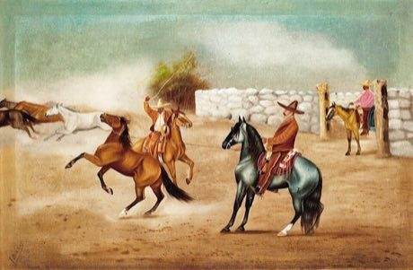

# Charro lasso roping

*Floreo de reata / lazo · lazo*

**Encyclopedia ID 60** (permanent) · https://equalinformation.com/world-heritage-games-site/games/60-charro-lasso-roping/

*Photo: Ernesto Icaza Sánchez, [Public domain](https://creativecommons.org/publicdomain/mark/1.0/), [source on Wikimedia Commons](https://commons.wikimedia.org/wiki/File:Un_buen_lazo.jpg)*

Swing a looped rope in graceful patterns, then throw it to catch a trotting target at the right moment, scoring for style and clean catches.

## Heritage note

Part of the living heritage of Mexico. Animals are partners in this tradition; good care and local rules always come first.

## Origins

Usually placed in the era of Age of Contact and Craft (about 1500 to 1800), although its exact origins are uncertain, within the cultural world of The Americas: Mesoamerica.

## Facts

- **Where:** Mexico
- **Type:** Dexterity and skill games
- **Family:** Puzzle and dexterity toys
- **Era:** [Age of Contact and Craft](../../eras/contact/index.md) (uncertain)
- **Cradle:** [The Americas: Mesoamerica](../../cradles/meso-america/index.md)
- **Region:** Americas

## Related entries

- [Fukuwarai](../../games/94-fukuwarai/index.md)
- [Sangaku Geometry Puzzles](../../games/109-sangaku-geometry-puzzles/index.md)
- [Lo Shu Magic Square](../../games/111-lo-shu-magic-square/index.md)
- [Intha leg rowing on the lake](../../games/304-intha-leg-rowing-on-the-lake/index.md)
- [Thung chai basket-boat spinning](../../games/308-thung-chai-basket-boat-spinning/index.md)
- [Stone Arch Bridge Builder](../../games/495-stone-arch-bridge-builder/index.md)

## Sources

- <https://commons.wikimedia.org/wiki/File:Un_buen_lazo.jpg>
