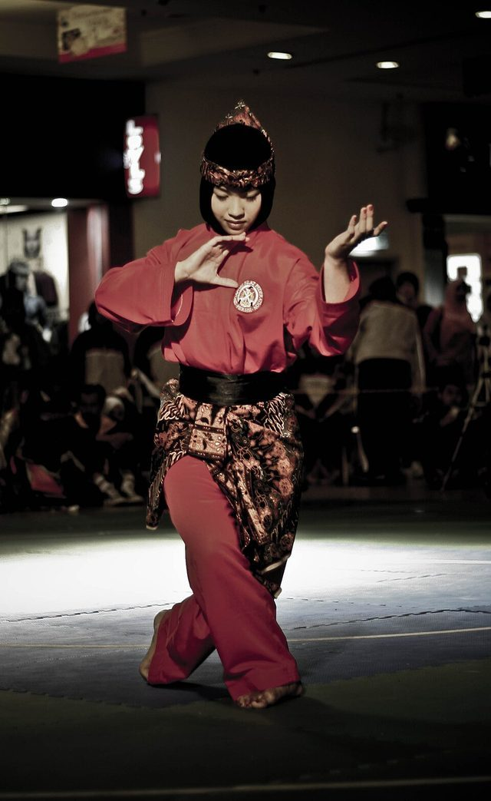

# Silat Melayu

*Also known as: Silat*

**Encyclopedia ID 605** (permanent) · https://bpupadhyaya.github.io/world-heritage-games-site/games/605-silat-melayu/

*Photo: Zaki Razali ., [CC BY 2.0](https://creativecommons.org/licenses/by/2.0/), [source on Wikimedia Commons](https://commons.wikimedia.org/wiki/File:Singaporean_female_pesilat_-_20080222.jpg)*

Malay martial art widely practiced, local variant Silat Suffian Bela Diri.

## Heritage note

Part of the living heritage of Brunei.

## Origins

Usually placed in the era of Modern Heritage (1800 to today), although its exact origins are uncertain, within the cultural world of Southeast Asia and the Islands.

## Facts

- **Where:** Brunei
- **Type:** Street and playground games
- **Era:** [Modern Heritage](../../eras/modern/index.md) (uncertain)
- **Cradle:** [Southeast Asia and the Islands](../../cradles/southeast-asia/index.md)
- **Region:** East and Southeast Asia
- **Players:** 2

## Related entries

- [Sepak takraw](../../games/802-sepak-takraw/index.md)
- [Gasing](../../games/908-gasing/index.md)
- [Chinlone](../../games/16-chinlone/index.md)
- [Tinikling](../../games/141-tinikling/index.md)
- [Luksong tinik](../../games/146-luksong-tinik/index.md)
- [Lato-lato](../../games/316-lato-lato/index.md)

## Sources

- <https://en.wikipedia.org/wiki/Sport_in_Brunei>
