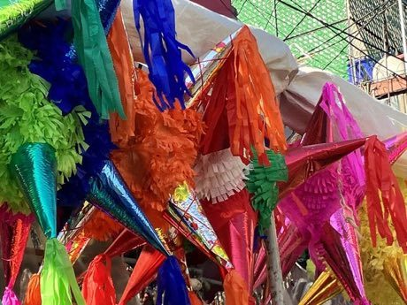

# Pinata swing

*Piñata · Piñata (clay pot)*

**Encyclopedia ID 61** (permanent) · https://equalinformation.com/world-heritage-games-site/games/61-pinata-swing/

*Photo: Paricutina, [CC0](https://creativecommons.org/publicdomain/zero/1.0/), [source on Wikimedia Commons](https://commons.wikimedia.org/wiki/File:Traditional_Mexican_Piñatas_02.jpg)*

Blindfolded or timing-based swings at a rope-hung paper star while it bobs, until a clean hit opens it.

## Heritage note

Part of the living heritage of Mexico. Some forms of this practice carry deep meaning for the communities who keep it; here we describe the play and the craft only, with respect for its roots.

## Origins

Usually placed in the era of Modern Heritage (1800 to today), although its exact origins are uncertain, within the cultural world of The Americas: Mesoamerica.

## Facts

- **Where:** Mexico, Paraguay
- **Type:** Dexterity and skill games
- **Family:** Winter sports
- **Era:** [Modern Heritage](../../eras/modern/index.md) (uncertain)
- **Cradle:** [The Americas: Mesoamerica](../../cradles/meso-america/index.md)
- **Region:** Americas
- **Players:** groups

## Related entries

- [Chinlone](../../games/16-chinlone/index.md)
- [Ring Tilting](../../games/65-ring-tilting/index.md)
- [Yukigassen Snow Fort](../../games/71-yukigassen-snow-fort/index.md)
- [Bagatelle](../../games/72-bagatelle/index.md)
- [Plate Spinning](../../games/73-plate-spinning/index.md)
- [Nguni stick-fighting rhythm skirmish](../../games/209-nguni-stick-fighting-rhythm-skirmish/index.md)

## Sources

- <https://commons.wikimedia.org/wiki/File:Traditional_Mexican_Piñatas_02.jpg>
- <https://www.portalguarani.com/687_florentin_gimenez__/22554_juegos_tradicionales_del_paraguay__por_florentin_gimenez.html>
