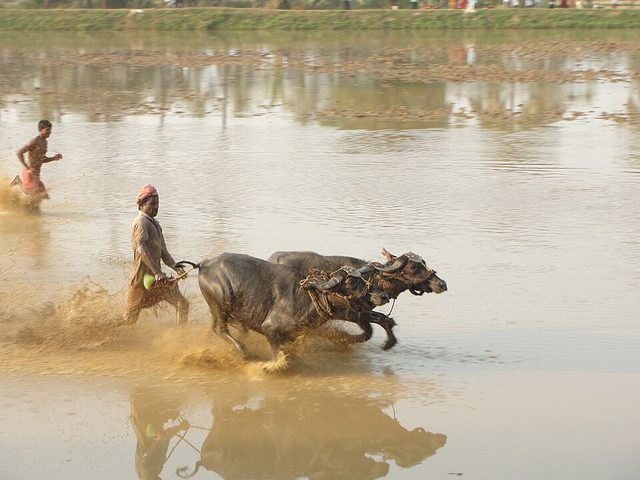

# Buffalo race

*Also known as: Bull racing*

**Encyclopedia ID 613** (permanent) · https://bpupadhyaya.github.io/world-heritage-games-site/games/613-buffalo-race/

*Photo: Rayabhari, [CC BY-SA 3.0](https://creativecommons.org/licenses/by-sa/3.0/), [source on Wikimedia Commons](https://commons.wikimedia.org/wiki/File:Kambala,_he-buffalo_race_at_Vandar_village,_Udupi_Dist.,_Kar._India.jpg)*

Water buffalo pairs race along a road, as at the Pchum Ben pagoda event since the 1920s.

## Heritage note

Part of the living heritage of Cambodia.

## Origins

Usually placed in the era of Modern Heritage (1800 to today), although its exact origins are uncertain, within the cultural world of Southeast Asia and the Islands.

## Facts

- **Where:** Cambodia
- **Type:** Street and playground games
- **Era:** [Modern Heritage](../../eras/modern/index.md) (uncertain)
- **Cradle:** [Southeast Asia and the Islands](../../cradles/southeast-asia/index.md)
- **Region:** East and Southeast Asia
- **Players:** 2

## Related entries

- [Scarf-ball toss](../../games/614-scarf-ball-toss/index.md)
- [Hide the scarf](../../games/615-hide-the-scarf/index.md)
- [Chinlone](../../games/16-chinlone/index.md)
- [Tinikling](../../games/141-tinikling/index.md)
- [Luksong tinik](../../games/146-luksong-tinik/index.md)
- [Lato-lato](../../games/316-lato-lato/index.md)

## Sources

- <https://vietnamnews.vn/life-style/1695148/bull-race-celebrates-khmer-heritage-and-tradition.html>
