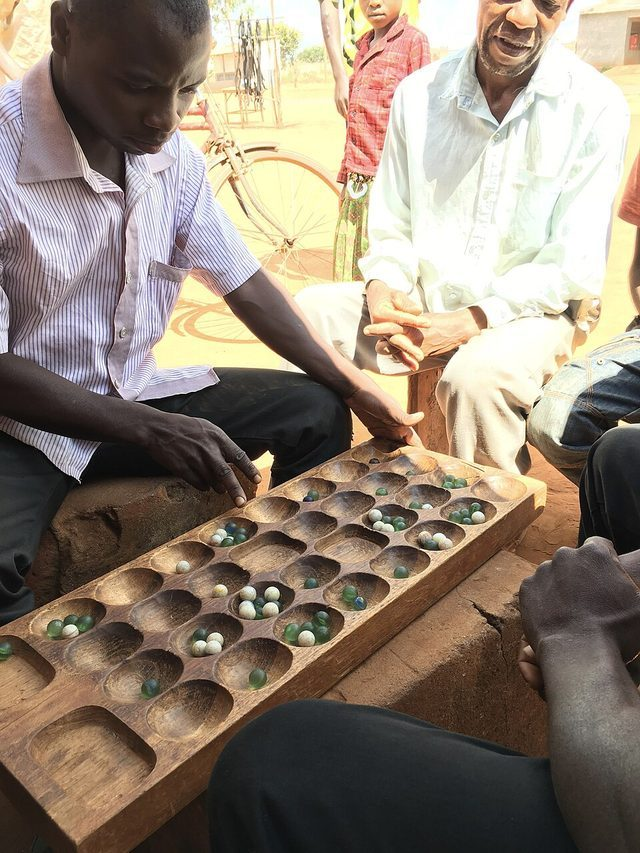

# Songo

*Also known as: Songo'o · Songho · Songoh · Songo ewondo · mbekh ô kôla (Gabon) · 14-house mancala*

**Encyclopedia ID 617** (permanent) · https://bpupadhyaya.github.io/world-heritage-games-site/games/617-songo/

*Photo: MozMozJ, [CC BY-SA 4.0](https://creativecommons.org/licenses/by-sa/4.0/), [source on Wikimedia Commons](https://commons.wikimedia.org/wiki/File:Yao_People_Playing_%22Bawo%22.jpg)*

Two-row, 14-house sowing game with five seeds per house, played by Ekang/Beti/Fang peoples; first to bank 40 wins.

## How it is played

Two-row, 14-house sowing game with five seeds per house, played by Ekang/Beti/Fang peoples; first to bank 40 wins. A strategic game used socially for reconciliation.

## Heritage note

Part of the living heritage of Cameroon, Gabon, Equatorial Guinea.

## Origins

Usually placed in the era of Deep Past and First Games (before about 3000 BCE), although its exact origins are uncertain, within the cultural world of Africa: Sahel, West and Central.

## Facts

- **Where:** Cameroon, Gabon, Equatorial Guinea, DR Congo
- **Type:** Board and table games
- **Family:** Mancala and sowing games
- **Era:** [Deep Past and First Games](../../eras/deep-past/index.md) (uncertain)
- **Cradle:** [Africa: Sahel, West and Central](../../cradles/africa-west/index.md)
- **Region:** Sub-Saharan Africa
- **Players:** 2

## Play it

[Web preview](https://bpupadhyaya.github.io/games-site/games/songo-sowing/play/) · [Google Play](https://play.google.com/store/apps/details?id=com.equalinformation.arcforge.shell) · [App Store](https://apps.apple.com/us/app/arcforge-world-heritage-games/id6813746442)

## Related entries

- [Kisolo](../../games/666-kisolo/index.md)
- [Mangola](../../games/668-mangola/index.md)
- [Local mancala variants](../../games/698-local-mancala-variants/index.md)
- [Kale](../../games/732-kale/index.md)
- [Oware](../../games/749-oware/index.md)
- [Oware-family mancala](../../games/587-oware-family-mancala/index.md)

## Sources

- <https://boardgamegeek.com/boardgame/137560/songo-ewondo>
- <https://mancala.fandom.com/wiki/Songo_Ewondo>
- <https://afrique.le360.ma/gabon/societe/2021/08/07/35069-video-le-songo-jeu-seculaire-populaire-africain-trait-dunion-entre-gabonais-35069/>
- <https://40.cerdotola.org/concours-jeux/finale-songoo-awale>
