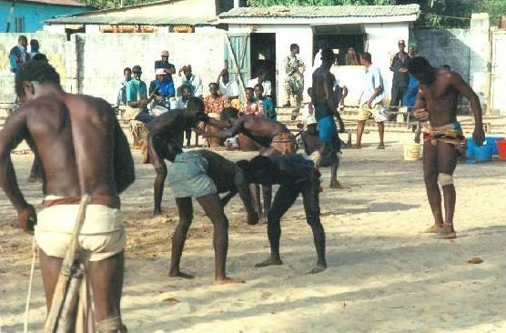

# Traditional wrestling

*Also known as: Lutte traditionnelle · Lutte*

**Encyclopedia ID 619** (permanent) · https://bpupadhyaya.github.io/world-heritage-games-site/games/619-traditional-wrestling/

*Photo: uploader Atamari has eMail-contact with the photograph „ sachara “, [CC BY-SA 3.0](https://creativecommons.org/licenses/by-sa/3.0/), [source on Wikimedia Commons](https://commons.wikimedia.org/wiki/File:The_match-The_Gambia.jpg)*

Village wrestling tradition across Cameroon with its own national association.

## Heritage note

Part of the living heritage of Cameroon.

## Origins

Usually placed in the era of River Valleys and First Cities (about 3000 to 1000 BCE), although its exact origins are uncertain, within the cultural world of Africa: Sahel, West and Central.

## Facts

- **Where:** Cameroon
- **Type:** Street and playground games
- **Family:** Wrestling
- **Era:** [River Valleys and First Cities](../../eras/river-valleys/index.md) (uncertain)
- **Cradle:** [Africa: Sahel, West and Central](../../cradles/africa-west/index.md)
- **Region:** Sub-Saharan Africa
- **Players:** 2

## Related entries

- [Laamb Wrestling Bout](../../games/166-laamb-wrestling-bout/index.md)
- [Kokawa Hausa Wrestling](../../games/1316-kokawa-hausa-wrestling/index.md)
- [Kurash](../../games/253-kurash/index.md)
- [Kushti / Pehlwani mud wrestling](../../games/256-kushti-pehlwani-mud-wrestling/index.md)
- [Sumo bout](../../games/359-sumo-bout/index.md)
- [Ssireum](../../games/366-ssireum/index.md)

## Sources

- <https://en.wikipedia.org/wiki/Lutte_Traditionnelle>
