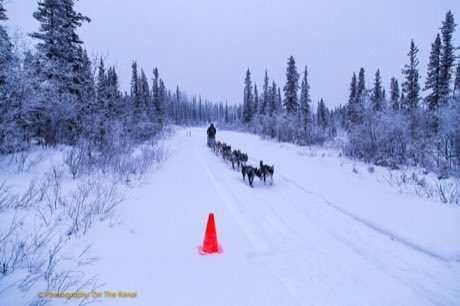

# Sled dog race

*Dog mushing*

**Encyclopedia ID 62** (permanent) · https://bpupadhyaya.github.io/world-heritage-games-site/games/62-sled-dog-race/

*Photo: U.S. Department of Agriculture, [Public domain](https://creativecommons.org/publicdomain/mark/1.0/), [source on Wikimedia Commons](https://commons.wikimedia.org/wiki/File:Musher_Heidi_Sutter_and_dog_sled_team_(16644205662).jpg)*

Steer a team across a snowy trail, managing dog stamina, speed and checkpoints to beat the clock.

## Heritage note

Part of the living heritage of United States, Canada. Animals are partners in this tradition; good care and local rules always come first.

## Origins

Usually placed in the era of Age of Contact and Craft (about 1500 to 1800), although its exact origins are uncertain, within the cultural world of The Americas: North America.

## Facts

- **Where:** United States, Canada
- **Type:** Racing
- **Family:** Winter sports
- **Era:** [Age of Contact and Craft](../../eras/contact/index.md) (uncertain)
- **Cradle:** [The Americas: North America](../../cradles/north-america/index.md)
- **Region:** Americas

## Related entries

- [Finnish pin toss](../../games/49-finnish-pin-toss/index.md)
- [Kicksled Race](../../games/407-kicksled-race/index.md)
- [Barrel racing](../../games/439-barrel-racing/index.md)
- [Tractor pull](../../games/440-tractor-pull/index.md)
- [Maple taffy on snow](../../games/441-maple-taffy-on-snow/index.md)
- [Axe throwing](../../games/442-axe-throwing/index.md)

## Sources

- <https://commons.wikimedia.org/wiki/File:Musher_Heidi_Sutter_and_dog_sled_team_(16644205662).jpg>
