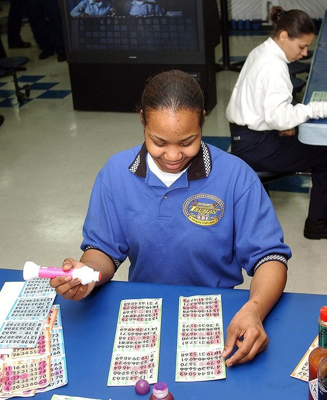

# Bingo

*Also known as: Beano*

**Encyclopedia ID 622** (permanent) · https://bpupadhyaya.github.io/world-heritage-games-site/games/622-bingo/

*Photo: Eric S. Garst, [Public domain](https://creativecommons.org/publicdomain/mark/1.0/), [source on Wikimedia Commons](https://commons.wikimedia.org/wiki/File:Bingo.jpg)*

Number-calling card game run at halls and fundraisers.

## Heritage note

Part of the living heritage of Canada.

## Origins

Usually placed in the era of Crossroads and Golden Ages (about 500 to 1500), although its exact origins are uncertain, within the cultural world of The Americas: North America.

## Facts

- **Where:** Canada
- **Type:** Board and table games
- **Era:** [Crossroads and Golden Ages](../../eras/crossroads/index.md) (uncertain)
- **Cradle:** [The Americas: North America](../../cradles/north-america/index.md)
- **Region:** Americas
- **Players:** any

## Related entries

- [Chickenfoot](../../games/1193-chickenfoot/index.md)
- [Texas 42](../../games/1195-texas-42/index.md)
- [Spelling Bee](../../games/1429-spelling-bee/index.md)
- [Horseshoe pitching](../../games/50-horseshoe-pitching/index.md)
- [Log rolling](../../games/59-log-rolling/index.md)
- [Sled dog race](../../games/62-sled-dog-race/index.md)
