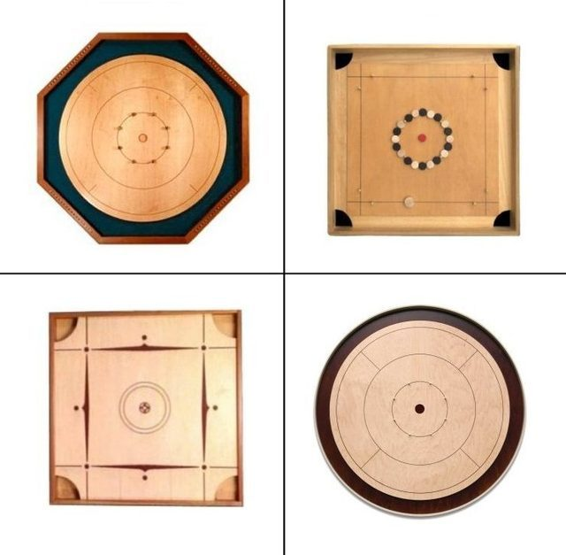

# Crokinole

*Also known as: Pichenotte · Crokinole board*

**Encyclopedia ID 623** (permanent) · https://bpupadhyaya.github.io/world-heritage-games-site/games/623-crokinole/

*Photo: David Victor Lagasse, [CC BY-SA 4.0](https://creativecommons.org/licenses/by-sa/4.0/), [source on Wikimedia Commons](https://commons.wikimedia.org/wiki/File:FAMILY_OF_PICHENOTTE_GAMES.jpg)*

Flick wooden discs across a board toward a 20-point center hole while avoiding pegs.

## Heritage note

Part of the living heritage of Canada.

## Origins

Usually placed in the era of Modern Heritage (1800 to today), although its exact origins are uncertain, within the cultural world of The Americas: North America.

## Facts

- **Where:** Canada
- **Type:** Dexterity and skill games
- **Family:** Puzzle and dexterity toys
- **Era:** [Modern Heritage](../../eras/modern/index.md) (uncertain)
- **Cradle:** [The Americas: North America](../../cradles/north-america/index.md)
- **Region:** Americas
- **Players:** 2 or 4

## Play it

[Web preview](https://bpupadhyaya.github.io/games-site/games/crokinole-disc-flick/) · [Google Play](https://play.google.com/store/apps/details?id=com.equalinformation.arcforge.shell) · [App Store](https://apps.apple.com/us/app/arcforge-world-heritage-games/id6813746442)

## Related entries

- [Square dance caller](../../games/129-square-dance-caller/index.md)
- [Cornhole](../../games/1194-cornhole/index.md)
- [Table shuffleboard](../../games/1199-table-shuffleboard/index.md)
- [Trick Roping](../../games/1408-trick-roping/index.md)
- [Kingyo-sukui](../../games/3-kingyo-sukui/index.md)
- [Stone Skipping](../../games/5-stone-skipping/index.md)

## Sources

- <https://www.canadashistory.ca/explore/arts-culture-society/crokinole>
- <https://www.cbc.ca/newsinteractives/features/crokinole-country>
- <https://www.granthaven.com/post/world-crokinole-championship-celebrates-25-years-in-tavistock>
- <https://en.wikipedia.org/wiki/Pichenotte>
