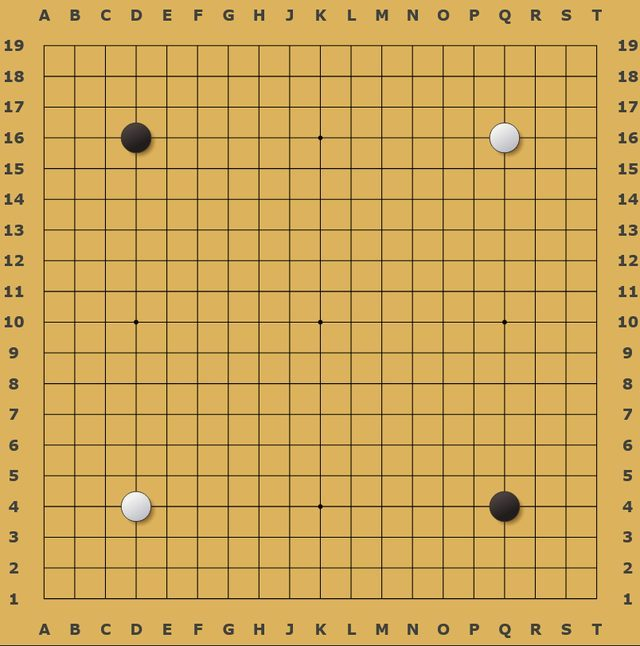

# Go

*Also known as: 围棋 Wéiqí · Baduk · Igo*

**Encyclopedia ID 634** (permanent) · https://bpupadhyaya.github.io/world-heritage-games-site/games/634-go/

*Photo: Javierfv1212, [CC0](https://creativecommons.org/publicdomain/zero/1.0/), [source on Wikimedia Commons](https://commons.wikimedia.org/wiki/File:Setup_of_Ancient_Chinese_Weiqi_(Go).png)*

Players alternately place stones on a 19x19 line grid to surround territory and capture enemy stones.

## Heritage note

Part of the living heritage of China, Japan, Taiwan.

## Origins

Usually placed in the era of Classical Worlds (about 1000 BCE to 500 CE), although its exact origins are uncertain, within the cultural world of China.

## Facts

- **Where:** China, Japan, Taiwan
- **Type:** Board and table games
- **Family:** Go family
- **Era:** [Classical Worlds](../../eras/classical/index.md) (uncertain)
- **Cradle:** [China](../../cradles/china/index.md)
- **Region:** East and Southeast Asia
- **Players:** 2

## Play it

[Try a 90-second preview in your browser](https://bpupadhyaya.github.io/games-site/games/go-stones-and-territory/play/) · [Google Play](https://play.google.com/store/apps/details?id=com.equalinformation.arcforge.shell) · [App Store](https://apps.apple.com/us/app/arcforge-world-heritage-games/id6813746442)

## Related entries

- [Baduk](../../games/1084-baduk/index.md)
- [Tea Horse Road Caravan](../../games/39-tea-horse-road-caravan/index.md)
- [Dizi](../../games/132-dizi/index.md)
- [Cuju](../../games/333-cuju/index.md)
- [Guzheng](../../games/334-guzheng/index.md)
- [Dougong Bracket Stacking](../../games/504-dougong-bracket-stacking/index.md)

## Sources

- <https://en.wikipedia.org/wiki/Go_(game)>
- <https://en.wikipedia.org/wiki/International_Go_Federation>
- <https://www.globaltimes.cn/page/202309/1298216.shtml>
- <https://en.wikipedia.org/wiki/Nihon_Ki-in>
