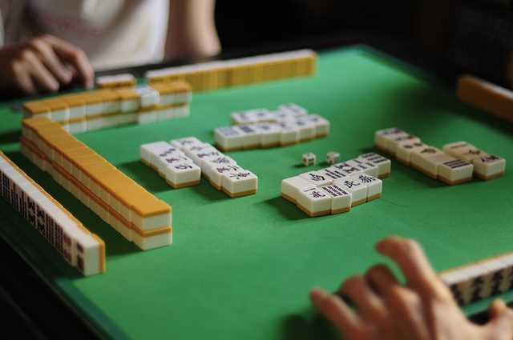

# Mahjong

*Also known as: 麻将 Májiàng (Guobiao, Sichuan, Guangdong) · Mah-jong · mainland rulesets*

**Encyclopedia ID 635** (permanent) · https://bpupadhyaya.github.io/world-heritage-games-site/games/635-mahjong/

*Photo: yui*, [CC BY-SA 2.0](https://creativecommons.org/licenses/by-sa/2.0/), [source on Wikimedia Commons](https://commons.wikimedia.org/wiki/File:Mahjong_game.jpg)*

Four players draw and discard tiles to build four sets and a pair; mainland China plays many local rulesets, with Guobiao as the official competition standard.

## Heritage note

Part of the living heritage of China, Singapore.

## Origins

Usually placed in the era of Crossroads and Golden Ages (about 500 to 1500), although its exact origins are uncertain, within the cultural world of China.

## Facts

- **Where:** China, Singapore
- **Type:** Board and table games
- **Family:** Dominoes and tile games
- **Era:** [Crossroads and Golden Ages](../../eras/crossroads/index.md) (uncertain)
- **Cradle:** [China](../../cradles/china/index.md)
- **Region:** East and Southeast Asia
- **Players:** 4

## Play it

[About the game](https://bpupadhyaya.github.io/games-site/games/mahjong-four-winds/) · [Google Play](https://play.google.com/store/apps/details?id=com.equalinformation.arcforge.shell) · [App Store](https://apps.apple.com/us/app/arcforge-world-heritage-games/id6813746442)

## Related entries

- [Pai gow](../../games/771-pai-gow/index.md)
- [Hong Kong mahjong](../../games/772-hong-kong-mahjong/index.md)
- [Tien gow](../../games/773-tien-gow/index.md)
- [Cafe dominoes](../../games/690-cafe-dominoes/index.md)
- [Rummikub](../../games/826-rummikub/index.md)
- [Riichi mahjong](../../games/851-riichi-mahjong/index.md)

## Sources

- <https://en.wikipedia.org/wiki/Mahjong>
- <https://en.wikipedia.org/wiki/Mahjong_culture>
- <https://wizardofmacau.com/en/games/mahjongpaigow>
