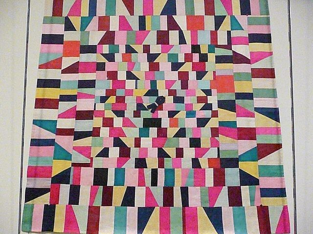

# American patchwork quilting

*Also known as: Patchwork quilt · Quilting*

**Encyclopedia ID 6356** (permanent) · https://bpupadhyaya.github.io/world-heritage-games-site/games/6356-american-patchwork-quilting/

*Photo: by angela n., [CC BY 2.0](https://creativecommons.org/licenses/by/2.0/), [source on Wikimedia Commons](https://commons.wikimedia.org/wiki/File:Korea-Joseon-Bojagi-01.jpg)*

A tradition of stitching small pieces of fabric into patterned tops that are then layered and quilted.

## How it is played

Quilters cut and sew pieces into blocks, then stitch through layers of cloth.

## Heritage note

Part of the living heritage of United States.

## Origins

A living tradition passed from person to person; it is not tied to a single dated origin. It belongs to the cultural world of The Americas: North America.

## Facts

- **Where:** United States
- **Type:** Crafts and making
- **Family:** Textile and weaving crafts
- **Era:** [Living Traditions](../../eras/living/index.md)
- **Cradle:** [The Americas: North America](../../cradles/north-america/index.md)
- **Region:** Americas
- **Players:** solo

## Play it

[Try a 90-second preview in your browser](https://bpupadhyaya.github.io/games-site/games/quilt-patterns-blocks/play/) · [Google Play](https://play.google.com/store/apps/details?id=com.equalinformation.arcforge.shell) · [App Store](https://apps.apple.com/us/app/arcforge-world-heritage-games/id6813746442)

## Related entries

- [Kente strip weaving](../../games/22-kente-strip-weaving/index.md)
- [Celtic knot weave](../../games/25-celtic-knot-weave/index.md)
- [Sashiko Stitch Patterns](../../games/27-sashiko-stitch-patterns/index.md)
- [Adire indigo resist dyeing](../../games/87-adire-indigo-resist-dyeing/index.md)
- [Agaseke basket weaving](../../games/89-agaseke-basket-weaving/index.md)
- [Toquilla straw hat weaving](../../games/93-toquilla-straw-hat-weaving/index.md)

## Sources

- <https://en.wikipedia.org/wiki/Patchwork>
