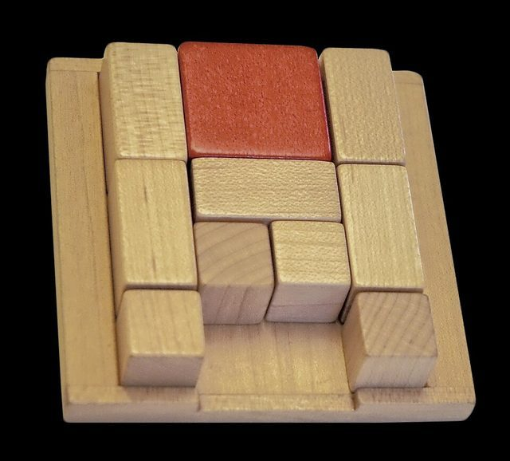

# Huarong Dao

*Also known as: Klotski*

**Encyclopedia ID 639** (permanent) · https://bpupadhyaya.github.io/world-heritage-games-site/games/639-huarong-dao/

*Photo: Welt-der-Form, [CC BY-SA 3.0](https://creativecommons.org/licenses/by-sa/3.0/), [source on Wikimedia Commons](https://commons.wikimedia.org/wiki/File:Quo_Vadis-HABA.jpg)*

Sliding-block puzzle on a 4x5 grid where the large Cao Cao block must be walked out through the bottom exit.

## Heritage note

Part of the living heritage of China.

## Origins

Usually placed in the era of Modern Heritage (1800 to today), although its exact origins are uncertain, within the cultural world of China.

## Facts

- **Where:** China
- **Type:** Water and winter sports
- **Family:** Puzzle and dexterity toys
- **Era:** [Modern Heritage](../../eras/modern/index.md) (uncertain)
- **Cradle:** [China](../../cradles/china/index.md)
- **Region:** East and Southeast Asia
- **Players:** 1

## Play it

[Web preview](https://bpupadhyaya.github.io/games-site/games/huarong-dao-sliding-puzzle/play/) · [Google Play](https://play.google.com/store/apps/details?id=com.equalinformation.arcforge.shell) · [App Store](https://apps.apple.com/us/app/arcforge-world-heritage-games/id6813746442)

## Related entries

- [Luban lock](../../games/99-luban-lock/index.md)
- [Tangram](../../games/641-tangram/index.md)
- [Kingyo-sukui](../../games/3-kingyo-sukui/index.md)
- [Stone Skipping](../../games/5-stone-skipping/index.md)
- [Disc-flip](../../games/8-disc-flip/index.md)
- [Sjoelen](../../games/9-sjoelen/index.md)

## Sources

- <https://en.wikipedia.org/wiki/Klotski>
