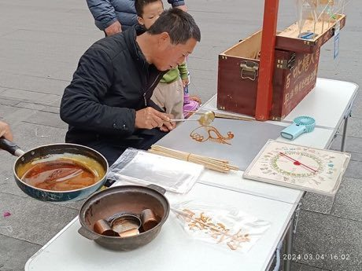

# Tanghua

*糖画 · hot sugar drawing*

**Encyclopedia ID 64** (permanent) · https://bpupadhyaya.github.io/world-heritage-games-site/games/64-tanghua/

*Photo: LAU 3420 LUONG, [CC0](https://creativecommons.org/publicdomain/zero/1.0/), [source on Wikimedia Commons](https://commons.wikimedia.org/wiki/File:SZ_深圳_Shenzhen_龍華_Longhua_三聯路_Sanlian_Road_冰糖_Tanghua_藝術字畫_Sugar_art_painting_n_writing_March_2024_R12S_01.jpg)*

Pour hot syrup in one continuous line to draw a dragon-free animal or flower, with flow speed and hand steadiness deciding the result; stick it and the shape lifts.

## Heritage note

Part of the living heritage of China. Animals are partners in this tradition; good care and local rules always come first.

## Origins

A living tradition passed from person to person; it is not tied to a single dated origin. It belongs to the cultural world of China.

## Facts

- **Where:** China
- **Type:** Crafts and making
- **Era:** [Living Traditions](../../eras/living/index.md)
- **Cradle:** [China](../../cradles/china/index.md)
- **Region:** East and Southeast Asia

## Related entries

- [Chinese knotting](../../games/26-chinese-knotting/index.md)
- [Chuiwan](../../games/332-chuiwan/index.md)
- [Bianzhong](../../games/336-bianzhong/index.md)
- [Lamian](../../games/340-lamian/index.md)
- [Seal carving](../../games/341-seal-carving/index.md)
- [Cloisonne](../../games/343-cloisonne/index.md)

## Sources

- <https://commons.wikimedia.org/wiki/File:SZ_深圳_Shenzhen_龍華_Longhua_三聯路_Sanlian_Road_冰糖_Tanghua_藝術字畫_Sugar_art_painting_n_writing_March_2024_R12S_01.jpg>
