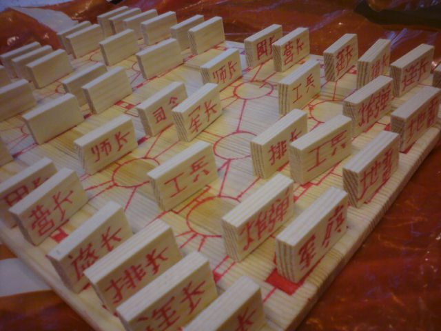

# Luzhanqi

*Also known as: 军棋 Jūnqí (Luzhanqi) · Land battle chess · Army chess*

**Encyclopedia ID 640** (permanent) · https://bpupadhyaya.github.io/world-heritage-games-site/games/640-luzhanqi/

*Photo: en:User:Painocus Painocus, [CC BY-SA 3.0](https://creativecommons.org/licenses/by-sa/3.0/), [source on Wikimedia Commons](https://commons.wikimedia.org/wiki/File:Luzhanqi.JPG)*

Hidden-rank pieces move along railways and posts on a 65-space board; the aim is to capture the opposing flag.

## Heritage note

Part of the living heritage of China.

## Origins

Usually placed in the era of Crossroads and Golden Ages (about 500 to 1500), although its exact origins are uncertain, within the cultural world of China.

## Facts

- **Where:** China
- **Type:** Board and table games
- **Family:** Chess family
- **Era:** [Crossroads and Golden Ages](../../eras/crossroads/index.md) (uncertain)
- **Cradle:** [China](../../cradles/china/index.md)
- **Region:** East and Southeast Asia
- **Players:** 2

## Related entries

- [Banqi](../../games/1437-banqi/index.md)
- [Xiangqi](../../games/636-xiangqi/index.md)
- [Chaturanga](../../games/45-chaturanga/index.md)
- [Sittuyin](../../games/302-sittuyin/index.md)
- [Chess](../../games/552-chess/index.md)
- [Senterej](../../games/707-senterej/index.md)

## Sources

- <https://en.wikipedia.org/wiki/Luzhanqi>
