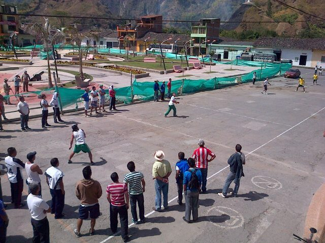

# Chaza

**Encyclopedia ID 643** (permanent) · https://bpupadhyaya.github.io/world-heritage-games-site/games/643-chaza/

*Photo: Jhon estrada, [CC BY-SA 4.0](https://creativecommons.org/licenses/by-sa/4.0/), [source on Wikimedia Commons](https://commons.wikimedia.org/wiki/File:Chaza.jpg)*

Old Colombian ball-and-board striking game said to be among the country's oldest sports.

## Heritage note

Part of the living heritage of Colombia.

## Origins

Usually placed in the era of Modern Heritage (1800 to today), although its exact origins are uncertain, within the cultural world of The Americas: Andes and South America.

## Facts

- **Where:** Colombia
- **Type:** Street and playground games
- **Era:** [Modern Heritage](../../eras/modern/index.md) (uncertain)
- **Cradle:** [The Americas: Andes and South America](../../cradles/andes-south-america/index.md)
- **Region:** Americas
- **Players:** teams

## Related entries

- [Tejo](../../games/57-tejo/index.md)
- [Atarraya](../../games/1434-atarraya/index.md)
- [Rana](../../games/645-rana/index.md)
- [Yermis](../../games/646-yermis/index.md)
- [Peteca](../../games/421-peteca/index.md)
- [Emboque](../../games/629-emboque/index.md)

## Sources

- <https://es.wikipedia.org/wiki/Anexo:Juegos_de_Colombia>
- <http://enciclopedia.us.es/index.php/Juegos_tradicionales_(Colombia)>
