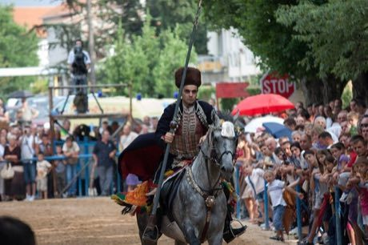

# Ring Tilting

*Sinjska alka · Sinj Alka*

**Encyclopedia ID 65** (permanent) · https://bpupadhyaya.github.io/world-heritage-games-site/games/65-ring-tilting/

*Photo: L. Carević, [CC0](https://creativecommons.org/publicdomain/zero/1.0/), [source on Wikimedia Commons](https://commons.wikimedia.org/wiki/File:Alka_-_Horseman.jpg)*

A rider gallops down a lane at full speed and tries to spear a small iron ring hung on a rope with a lance; score 1-3 depending on which part of the ring is hit.

## Heritage note

Part of the living heritage of Croatia. Some forms of this practice carry deep meaning for the communities who keep it; here we describe the play and the craft only, with respect for its roots. Animals are partners in this tradition; good care and local rules always come first. It is presented as sport and skill, never as real fighting.

## Origins

Usually placed in the era of Modern Heritage (1800 to today), although its exact origins are uncertain, within the cultural world of Mediterranean.

## Facts

- **Where:** Croatia
- **Type:** Dexterity and skill games
- **Family:** Winter sports
- **Era:** [Modern Heritage](../../eras/modern/index.md) (uncertain)
- **Cradle:** [Mediterranean](../../cradles/mediterranean/index.md)
- **Region:** Europe

## Related entries

- [Gondola Rowing](../../games/401-gondola-rowing/index.md)
- [Crossbow Target Match](../../games/1367-crossbow-target-match/index.md)
- [Chinlone](../../games/16-chinlone/index.md)
- [Pinata swing](../../games/61-pinata-swing/index.md)
- [Yukigassen Snow Fort](../../games/71-yukigassen-snow-fort/index.md)
- [Bagatelle](../../games/72-bagatelle/index.md)

## Sources

- <https://commons.wikimedia.org/wiki/File:Alka_-_Horseman.jpg>
