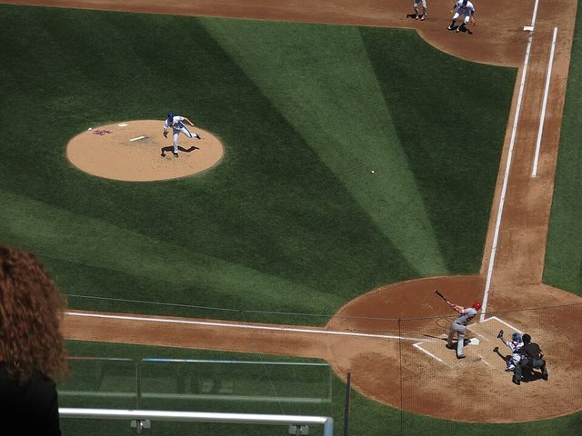

# Four Corners

*Also known as: Cuatro Esquinas · hand baseball*

**Encyclopedia ID 652** (permanent) · https://bpupadhyaya.github.io/world-heritage-games-site/games/652-four-corners/

*Photo: D. Benjamin Miller, [CC0](https://creativecommons.org/publicdomain/zero/1.0/), [source on Wikimedia Commons](https://commons.wikimedia.org/wiki/File:Tommy_Milone_gives_up_a_home_run_to_Mike_Trout_on_May_21,_2017.jpg)*

Rubber-ball street baseball hit with the hand, running around a square; ancestor of Baseball5.

## Heritage note

Part of the living heritage of Cuba.

## Origins

Usually placed in the era of Modern Heritage (1800 to today), although its exact origins are uncertain, within the cultural world of The Americas: Caribbean.

## Facts

- **Where:** Cuba
- **Type:** Street and playground games
- **Family:** Bat-and-ball games
- **Era:** [Modern Heritage](../../eras/modern/index.md) (uncertain)
- **Cradle:** [The Americas: Caribbean](../../cradles/caribbean/index.md)
- **Region:** Americas
- **Players:** 2 teams

## Related entries

- [Rounders](../../games/761-rounders/index.md)
- [Lapta](../../games/375-lapta/index.md)
- [Pesapallo](../../games/484-pesapallo/index.md)
- [Stoolball](../../games/492-stoolball/index.md)
- [Gilli-Danda](../../games/793-gilli-danda/index.md)
- [Taco bat game](../../games/655-taco-bat-game/index.md)

## Sources

- <https://en.wikipedia.org/wiki/Traditional_games_of_Cuba>
