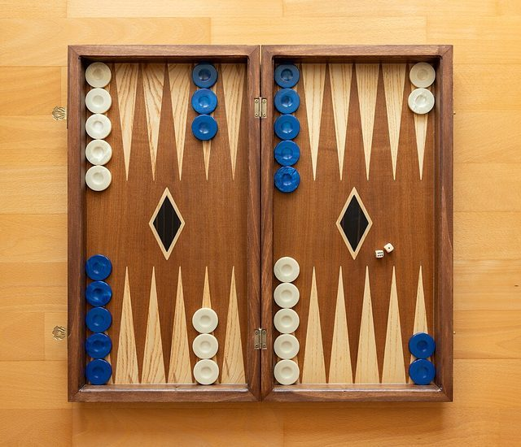

# Tavli

**Encyclopedia ID 656** (permanent) · https://bpupadhyaya.github.io/world-heritage-games-site/games/656-tavli/

*Photo: Nikos Kitsakis, [CC BY 4.0](https://creativecommons.org/licenses/by/4.0/), [source on Wikimedia Commons](https://commons.wikimedia.org/wiki/File:Tavli_Board_without_slots_(traditional)_C.jpg)*

Backgammon-family dice game played as a match of several variants in kafeneio cafes.

## Heritage note

Part of the living heritage of Cyprus, Greece.

## Origins

Usually placed in the era of River Valleys and First Cities (about 3000 to 1000 BCE), although its exact origins are uncertain, within the cultural world of Mediterranean.

## Facts

- **Where:** Cyprus, Greece
- **Type:** Board and table games
- **Family:** Race and cross games
- **Era:** [River Valleys and First Cities](../../eras/river-valleys/index.md) (uncertain)
- **Cradle:** [Mediterranean](../../cradles/mediterranean/index.md)
- **Region:** Europe
- **Players:** 2

## Play it

[Web preview](https://bpupadhyaya.github.io/games-site/games/tavli-kafeneio-trio/play/) · [Google Play](https://play.google.com/store/apps/details?id=com.equalinformation.arcforge.shell) · [App Store](https://apps.apple.com/us/app/arcforge-world-heritage-games/id6813746442)

## Related entries

- [Tavëll](../../games/527-tavell/index.md)
- [Tavla](../../games/992-tavla/index.md)
- [Parchís](../../games/1098-parchis/index.md)
- [Nardi](../../games/551-nardi/index.md)
- [Senet](../../games/693-senet/index.md)
- [Don't Get Angry](../../games/744-dont-get-angry/index.md)

## Sources

- <https://www.cyprusalive.com/en/paixnidia-pou-paizontai-stin-kipro-games-that-are-being-played-in-cyprus>
- <https://cyprustravellerguide.com/cypriot-backgammon-also-known-as-tavli/>
- <https://en.wikipedia.org/wiki/Tavli>
