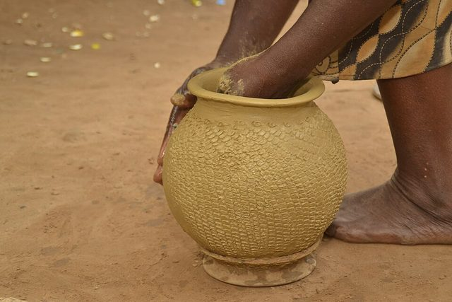

# Pottery

*Also known as: wheel*

**Encyclopedia ID 6593** (permanent) · https://bpupadhyaya.github.io/world-heritage-games-site/games/6593-pottery/

*Photo: Chukwukajustice, [CC BY-SA 4.0](https://creativecommons.org/licenses/by-sa/4.0/), [source on Wikimedia Commons](https://commons.wikimedia.org/wiki/File:Traditional_pottery_in_Nigeria_(Ikpu_ite)_19.jpg)*

Shaping clay on a spinning wheel into vessels, practised from ancient Mesopotamia onward.

## How it is played

Centre the clay on the wheel and pull walls up with the hands.

## Heritage note

A tradition shared by communities in many places.

## Origins

A living tradition passed from person to person; it is not tied to a single dated origin.

## Facts

- **Where:** Shared across many places
- **Type:** Crafts and making
- **Family:** Pottery, wood and metal crafts
- **Era:** [Living Traditions](../../eras/living/index.md)
- **Cradle:** [Shared across the world](../../cradles/worldwide/index.md)
- **Region:** Worldwide
- **Players:** 1

## Play it

[Try a 90-second preview in your browser](https://bpupadhyaya.github.io/games-site/games/pottery-wheel-throw/play/) · [Google Play](https://play.google.com/store/apps/details?id=com.equalinformation.arcforge.shell) · [App Store](https://apps.apple.com/us/app/arcforge-world-heritage-games/id6813746442)

## Related entries

- [Zellij tile mosaic](../../games/21-zellij-tile-mosaic/index.md)
- [Swahili carved door](../../games/90-swahili-carved-door/index.md)
- [Thai fruit and vegetable carving](../../games/114-thai-fruit-and-vegetable-carving/index.md)
- [Glassblowing](../../games/121-glassblowing/index.md)
- [Azulejo tile painting](../../games/122-azulejo-tile-painting/index.md)
- [Krobo Powder-Glass Beads](../../games/173-krobo-powder-glass-beads/index.md)

## Sources

- <https://en.wikipedia.org/wiki/Pottery>
