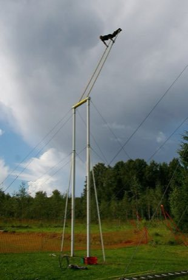

# Kiiking

*Kiiking · Giant Swing*

**Encyclopedia ID 66** (permanent) · https://bpupadhyaya.github.io/world-heritage-games-site/games/66-kiiking/

*Photo: Eesti Kiikingi Liit, [CC BY-SA 3.0](https://creativecommons.org/licenses/by-sa/3.0/), [source on Wikimedia Commons](https://commons.wikimedia.org/wiki/File:Kiiking_07.JPG)*

Standing on a giant swing with rigid arms, the player pumps by squatting and straightening at the right moments to swing ever higher and try to rotate a full 360 degrees over the top.

## Heritage note

Part of the living heritage of Estonia.

## Origins

Usually placed in the era of Modern Heritage (1800 to today), although its exact origins are uncertain, within the cultural world of Northern and Eastern Europe.

## Facts

- **Where:** Estonia
- **Type:** Puzzles and mind games
- **Family:** Puzzle and dexterity toys
- **Era:** [Modern Heritage](../../eras/modern/index.md) (uncertain)
- **Cradle:** [Northern and Eastern Europe](../../cradles/north-east-europe/index.md)
- **Region:** Europe

## Related entries

- [Nail driving](../../games/82-nail-driving/index.md)
- [Clockwork Movement Builder](../../games/502-clockwork-movement-builder/index.md)
- [Ringridning](../../games/1365-ringridning/index.md)
- [Kingyo-sukui](../../games/3-kingyo-sukui/index.md)
- [Stone Skipping](../../games/5-stone-skipping/index.md)
- [Disc-flip](../../games/8-disc-flip/index.md)

## Sources

- <https://commons.wikimedia.org/wiki/File:Kiiking_07.JPG>
