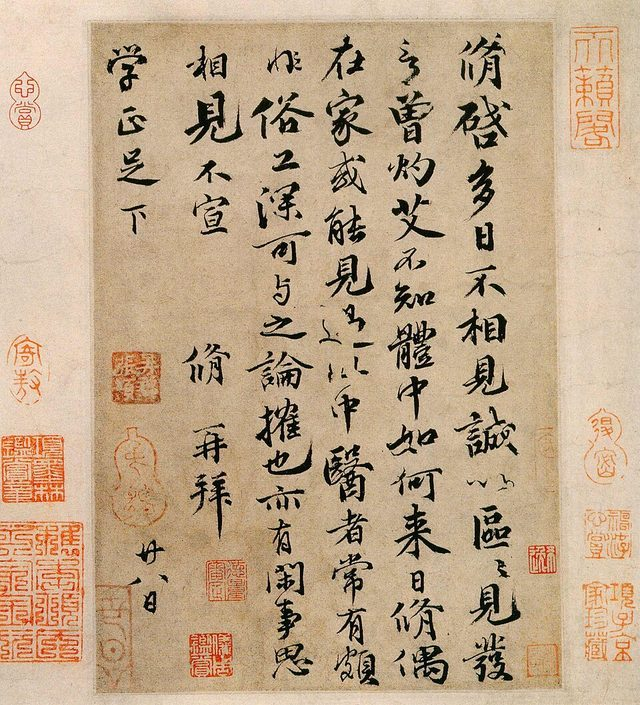

# Calligraphy

*Also known as: Brush calligraphy*

**Encyclopedia ID 6621** (permanent) · https://bpupadhyaya.github.io/world-heritage-games-site/games/6621-calligraphy/

*Photo: Unknown author Unknown author, [Public domain](https://creativecommons.org/publicdomain/mark/1.0/), [source on Wikimedia Commons](https://commons.wikimedia.org/wiki/File:Letter_by_Ouyang_Xiu.jpg)*

Decorative handwriting practised in China, Arabic and European traditions.

## How it is played

Write with brush or pen following set strokes.

## Heritage note

A tradition shared by communities in many places.

## Origins

A living tradition passed from person to person; it is not tied to a single dated origin.

## Facts

- **Where:** China
- **Type:** Crafts and making
- **Family:** Paper, ink and painting crafts
- **Era:** [Living Traditions](../../eras/living/index.md)
- **Cradle:** [Shared across the world](../../cradles/worldwide/index.md)
- **Region:** East and Southeast Asia
- **Players:** 1

## Play it

[Web preview](https://bpupadhyaya.github.io/games-site/games/ink-brush-strokes/play/) · [Google Play](https://play.google.com/store/apps/details?id=com.equalinformation.arcforge.shell) · [App Store](https://apps.apple.com/us/app/arcforge-world-heritage-games/id6813746442)

## Related entries

- [Ebru paper marbling](../../games/20-ebru-paper-marbling/index.md)
- [Ndebele geometric wall painting](../../games/23-ndebele-geometric-wall-painting/index.md)
- [Chinese knotting](../../games/26-chinese-knotting/index.md)
- [Matryoshka](../../games/28-matryoshka/index.md)
- [Bogolan mud cloth](../../games/86-bogolan-mud-cloth/index.md)
- [Zulu beadwork letters](../../games/88-zulu-beadwork-letters/index.md)

## Sources

- <https://en.wikipedia.org/wiki/Calligraphy>
