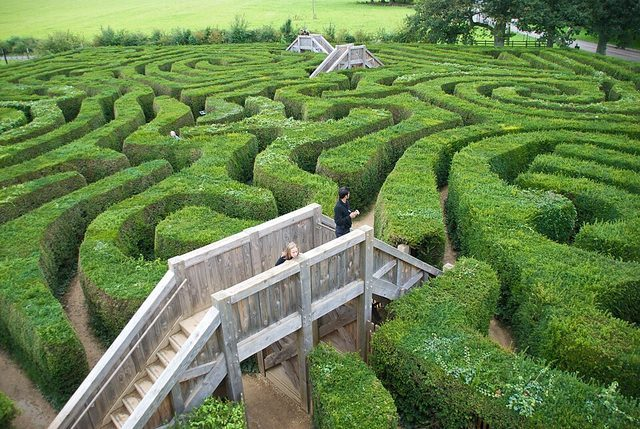

# Maze

*Also known as: Labyrinth*

**Encyclopedia ID 6640** (permanent) · https://bpupadhyaya.github.io/world-heritage-games-site/games/6640-maze/

*Photo: Niki Odolphie from Frome, England, [CC BY 2.0](https://creativecommons.org/licenses/by/2.0/), [source on Wikimedia Commons](https://commons.wikimedia.org/wiki/File:Longleat-maze.jpg)*

A path puzzle with branches and dead ends, drawn or built in many cultures.

## How it is played

Trace a path from entrance to exit.

## Heritage note

A tradition shared by communities in many places.

## Origins

Usually placed in the era of Modern Heritage (1800 to today), although its exact origins are uncertain.

## Facts

- **Where:** Greece
- **Type:** Puzzles and mind games
- **Family:** Puzzle and dexterity toys
- **Era:** [Modern Heritage](../../eras/modern/index.md) (uncertain)
- **Cradle:** [Shared across the world](../../cradles/worldwide/index.md)
- **Region:** Europe
- **Players:** 1

## Play it

[Try a 90-second preview in your browser](https://bpupadhyaya.github.io/games-site/games/labyrinth-thread-maze/play/) · [Google Play](https://play.google.com/store/apps/details?id=com.equalinformation.arcforge.shell) · [App Store](https://apps.apple.com/us/app/arcforge-world-heritage-games/id6813746442)

## Related entries

- [Kingyo-sukui](../../games/3-kingyo-sukui/index.md)
- [Disc-flip](../../games/8-disc-flip/index.md)
- [Sjoelen](../../games/9-sjoelen/index.md)
- [Secret Puzzle Box](../../games/29-secret-puzzle-box/index.md)
- [Shove ha'penny](../../games/54-shove-hapenny/index.md)
- [Limbo](../../games/58-limbo/index.md)

## Sources

- <https://en.wikipedia.org/wiki/Maze>
