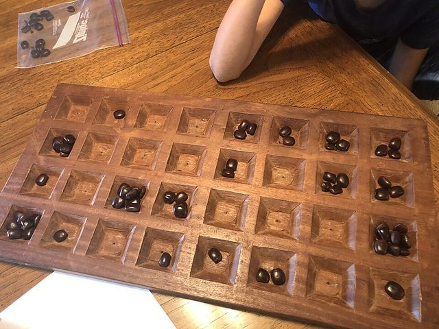

# Kisolo

*Also known as: Chisolo · 4x8 mancala*

**Encyclopedia ID 666** (permanent) · https://bpupadhyaya.github.io/world-heritage-games-site/games/666-kisolo/

*Photo: Eaglegrafix, [CC BY-SA 4.0](https://creativecommons.org/licenses/by-sa/4.0/), [source on Wikimedia Commons](https://commons.wikimedia.org/wiki/File:Kisolo-board-1965.jpg)*

Four-row mancala of the Luba, Lulua and Songye peoples; also in Zambia/Zimbabwe.

## Heritage note

Part of the living heritage of DR Congo, Zambia.

## Origins

Usually placed in the era of Deep Past and First Games (before about 3000 BCE), although its exact origins are uncertain, within the cultural world of Africa: Sahel, West and Central.

## Facts

- **Where:** DR Congo, Zambia
- **Type:** Board and table games
- **Family:** Mancala and sowing games
- **Era:** [Deep Past and First Games](../../eras/deep-past/index.md) (uncertain)
- **Cradle:** [Africa: Sahel, West and Central](../../cradles/africa-west/index.md)
- **Region:** Sub-Saharan Africa
- **Players:** 2

## Related entries

- [Songo](../../games/617-songo/index.md)
- [Mangola](../../games/668-mangola/index.md)
- [Oware](../../games/749-oware/index.md)
- [Oware-family mancala](../../games/587-oware-family-mancala/index.md)
- [Ouril](../../games/611-ouril/index.md)
- [Mancala-type sowing games](../../games/626-mancala-type-sowing-games/index.md)

## Sources

- <https://en.wikipedia.org/wiki/Kisolo>
- <https://mancala.fandom.com/wiki/Isolo_I>
- <https://en.wikipedia.org/wiki/Chisolo>
