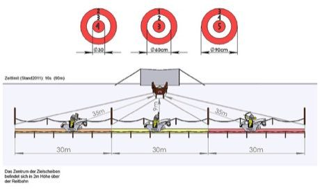

# Mounted Archery Course

*Lovasíjászat*

**Encyclopedia ID 67** (permanent) · https://bpupadhyaya.github.io/world-heritage-games-site/games/67-mounted-archery-course/

*Photo: Benjamin Diepolder, [CC BY-SA 3.0](https://creativecommons.org/licenses/by-sa/3.0/), [source on Wikimedia Commons](https://commons.wikimedia.org/wiki/File:Hungarian_competition_horseback_archery.jpg)*

A rider gallops along a 90 m track and shoots at targets to the side and rear on a time limit; each target ring is worth more points, with a 16-second run limit.

## Heritage note

Part of the living heritage of Hungary.

## Origins

Usually placed in the era of Classical Worlds (about 1000 BCE to 500 CE), although its exact origins are uncertain, within the cultural world of Northern and Eastern Europe.

## Facts

- **Where:** Hungary
- **Type:** Dexterity and skill games
- **Family:** Archery and target games
- **Era:** [Classical Worlds](../../eras/classical/index.md) (uncertain)
- **Cradle:** [Northern and Eastern Europe](../../cradles/north-east-europe/index.md)
- **Region:** Europe

## Related entries

- [Horseshoe pitching](../../games/50-horseshoe-pitching/index.md)
- [Lawn bowls](../../games/74-lawn-bowls/index.md)
- [Krulbol](../../games/1469-krulbol/index.md)
- [Mongolian Bow Archery](../../games/1476-mongolian-bow-archery/index.md)
- [Archery](../../games/591-archery/index.md)
- [Boules lyonnaises](../../games/730-boules-lyonnaises/index.md)

## Sources

- <https://commons.wikimedia.org/wiki/File:Hungarian_competition_horseback_archery.jpg>
