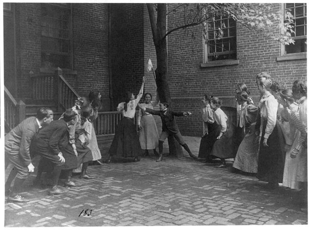

# Handkerchief game

*Also known as: Juego del Pañuelo*

**Encyclopedia ID 683** (permanent) · https://bpupadhyaya.github.io/world-heritage-games-site/games/683-handkerchief-game/

*Photo: Johnston, Frances Benjamin, 1864-1952, photographer, [Public domain](https://creativecommons.org/publicdomain/mark/1.0/), [source on Wikimedia Commons](https://commons.wikimedia.org/wiki/File:Children_playing_game_with_handkerchief_on_stick_in_school_yard,_Washington,_D.C._LCCN2001703698.jpg)*

A steal-the-bacon type children's game.

## Heritage note

Part of the living heritage of Dominican Republic.

## Origins

Usually placed in the era of Modern Heritage (1800 to today), although its exact origins are uncertain, within the cultural world of The Americas: Caribbean.

## Facts

- **Where:** Dominican Republic
- **Type:** Street and playground games
- **Era:** [Modern Heritage](../../eras/modern/index.md) (uncertain)
- **Cradle:** [The Americas: Caribbean](../../cradles/caribbean/index.md)
- **Region:** Americas
- **Players:** 2 teams

## Related entries

- [Spinning top](../../games/678-spinning-top/index.md)
- [Limbo](../../games/58-limbo/index.md)
- [Stickball](../../games/477-stickball/index.md)
- [Four Corners](../../games/652-four-corners/index.md)
- [Rounders](../../games/761-rounders/index.md)
- [Heritage games](../../games/1050-heritage-games/index.md)

## Sources

- <https://en.wikipedia.org/wiki/Traditional_games_of_the_Dominican_Republic>
