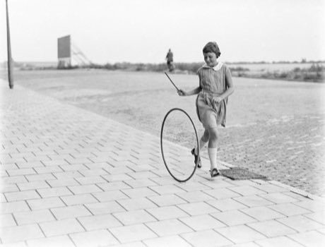

# Hoop Rolling Trundle

*Hoop trundling / hoopen*

**Encyclopedia ID 69** (permanent) · https://bpupadhyaya.github.io/world-heritage-games-site/games/69-hoop-rolling-trundle/

*Photo: Nationaal Archief, [CC BY 3.0](https://creativecommons.org/licenses/by/3.0/), [source on Wikimedia Commons](https://commons.wikimedia.org/wiki/File:Kind_hoepelen.jpg)*

Steer a rolling hoop with a stick through a course of gates and turns without letting it fall.

## Heritage note

Part of the living heritage of China.

## Origins

Usually placed in the era of Modern Heritage (1800 to today), although its exact origins are uncertain, within the cultural world of China.

## Facts

- **Where:** China
- **Type:** Street and playground games
- **Family:** Tops, kites and spinning toys
- **Era:** [Modern Heritage](../../eras/modern/index.md) (uncertain)
- **Cradle:** [China](../../cradles/china/index.md)
- **Region:** East and Southeast Asia

## Related entries

- [Amidakuji](../../games/357-amidakuji/index.md)
- [Gasing uri](../../games/1289-gasing-uri/index.md)
- [Spinning top](../../games/678-spinning-top/index.md)
- [Yo-yo](../../games/696-yo-yo/index.md)
- [Kendama](../../games/850-kendama/index.md)
- [Gasing](../../games/908-gasing/index.md)

## Sources

- <https://commons.wikimedia.org/wiki/File:Kind_hoepelen.jpg>
