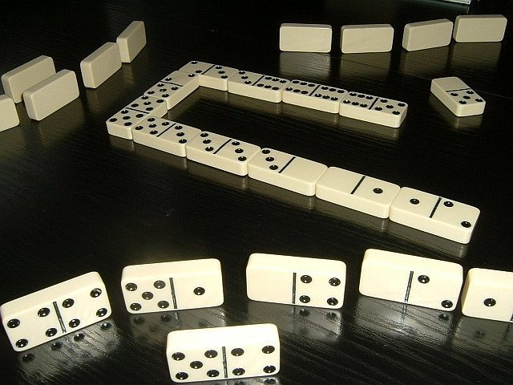

# Cafe dominoes

*Also known as: Domino · Domina*

**Encyclopedia ID 690** (permanent) · https://bpupadhyaya.github.io/world-heritage-games-site/games/690-cafe-dominoes/

*Photo: No machine-readable author provided. Peng assumed (based on copyright claims)., [CC BY-SA 3.0](https://creativecommons.org/licenses/by-sa/3.0/), [source on Wikimedia Commons](https://commons.wikimedia.org/wiki/File:Dominospiel.JPG)*

Tile-matching game played fast in coffeehouses, often as partnerships.

## Heritage note

Part of the living heritage of Egypt.

## Origins

Usually placed in the era of Crossroads and Golden Ages (about 500 to 1500), although its exact origins are uncertain, within the cultural world of Africa: Nile and the Horn.

## Facts

- **Where:** Egypt
- **Type:** Board and table games
- **Family:** Dominoes and tile games
- **Era:** [Crossroads and Golden Ages](../../eras/crossroads/index.md) (uncertain)
- **Cradle:** [Africa: Nile and the Horn](../../cradles/africa-nile/index.md)
- **Region:** Middle East and North Africa
- **Players:** 2-4

## Related entries

- [Mahjong](../../games/635-mahjong/index.md)
- [Rummikub](../../games/826-rummikub/index.md)
- [Riichi mahjong](../../games/851-riichi-mahjong/index.md)
- [Chickenfoot](../../games/1193-chickenfoot/index.md)
- [Texas 42](../../games/1195-texas-42/index.md)
- [Bahamian dominoes](../../games/569-bahamian-dominoes/index.md)
