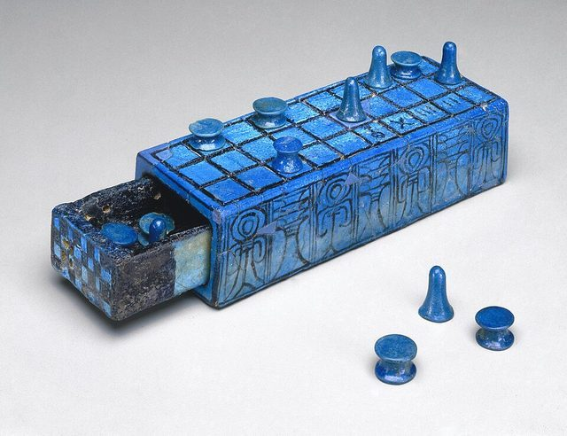

# Senet

**Encyclopedia ID 693** (permanent) · https://bpupadhyaya.github.io/world-heritage-games-site/games/693-senet/

*Photo: Charles Edwin Wilbour Fund, No restrictions, [source on Wikimedia Commons](https://commons.wikimedia.org/wiki/File:Gaming_Board_Inscribed_for_Amenhotep_III_with_Separate_Sliding_Drawer,_ca._1390-1353_B.C.E.,49.56a-b.jpg)*

Ancient Egyptian track race using throw sticks; reconstructed rules, strong museum-icon status.

## Heritage note

Part of the living heritage of Egypt.

## Origins

Usually placed in the era of River Valleys and First Cities (about 3000 to 1000 BCE), although its exact origins are uncertain, within the cultural world of Africa: Nile and the Horn.

## Facts

- **Where:** Egypt
- **Type:** Board and table games
- **Family:** Race and cross games
- **Era:** [River Valleys and First Cities](../../eras/river-valleys/index.md) (uncertain)
- **Cradle:** [Africa: Nile and the Horn](../../cradles/africa-nile/index.md)
- **Region:** Middle East and North Africa
- **Players:** 2

## Play it

[About the game](https://bpupadhyaya.github.io/games-site/games/senet-pharaohs-path/) · [Google Play](https://play.google.com/store/apps/details?id=com.equalinformation.arcforge.shell) · [App Store](https://apps.apple.com/us/app/arcforge-world-heritage-games/id6813746442)

## Related entries

- [Egyptian backgammon](../../games/695-egyptian-backgammon/index.md)
- [Nardi](../../games/551-nardi/index.md)
- [Tavli](../../games/656-tavli/index.md)
- [Don't Get Angry](../../games/744-dont-get-angry/index.md)
- [Ludo](../../games/763-ludo/index.md)
- [Royal Game of Ur](../../games/817-royal-game-of-ur/index.md)

## Sources

- <https://www.metmuseum.org/perspectives/ancient-egypt-board-games>
