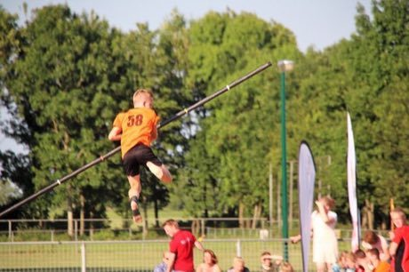

# Canal pole vault

*Fierljeppen / polsstokverspringen · Fierljeppen*

**Encyclopedia ID 7** (permanent) · https://equalinformation.com/world-heritage-games-site/games/7-canal-pole-vault/

*Photo: Peter van der Sluijs, [CC BY-SA 4.0](https://creativecommons.org/licenses/by-sa/4.0/), [source on Wikimedia Commons](https://commons.wikimedia.org/wiki/File:De_uitsprong_fierljeppen.jpg)*

Sprint, plant a long pole in the canal, climb it as it swings and leap across the water for the farthest landing.

## Heritage note

Part of the living heritage of Netherlands.

## Origins

Usually placed in the era of Modern Heritage (1800 to today), although its exact origins are uncertain, within the cultural world of Celtic and Atlantic Europe.

## Facts

- **Where:** Netherlands
- **Type:** Water and winter sports
- **Era:** [Modern Heritage](../../eras/modern/index.md) (uncertain)
- **Cradle:** [Celtic and Atlantic Europe](../../cradles/celtic-atlantic/index.md)
- **Region:** Europe

## Related entries

- [Sjoelen](../../games/9-sjoelen/index.md)
- [Korfball](../../games/481-korfball/index.md)
- [Fierljeppen](../../games/971-fierljeppen/index.md)
- [Frisian kaatsen](../../games/973-frisian-kaatsen/index.md)
- [Klootschieten](../../games/975-klootschieten/index.md)
- [Disc-flip](../../games/8-disc-flip/index.md)

## Sources

- <https://commons.wikimedia.org/wiki/File:De_uitsprong_fierljeppen.jpg>
