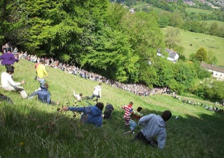

# Cheese Rolling Hill

*Cheese rolling*

**Encyclopedia ID 70** (permanent) · https://bpupadhyaya.github.io/world-heritage-games-site/games/70-cheese-rolling-hill/

*Photo: Dave Farrance, [CC BY-SA 3.0](https://creativecommons.org/licenses/by-sa/3.0/), [source on Wikimedia Commons](https://commons.wikimedia.org/wiki/File:A_race_at_the_Cooper's_Hill_Cheese_Rolling_and_Wake,_on_Cooper's_Hill,_Brockworth,_Gloucestershire,_on_27_May_2013.jpg)*

Launch a rolling wheel downhill then tumble after it, steering to stay upright and catch it first.

## Heritage note

Part of the living heritage of United Kingdom.

## Origins

Usually placed in the era of Modern Heritage (1800 to today), although its exact origins are uncertain, within the cultural world of Celtic and Atlantic Europe.

## Facts

- **Where:** United Kingdom
- **Type:** Racing
- **Family:** Tag, chase and hide games
- **Era:** [Modern Heritage](../../eras/modern/index.md) (uncertain)
- **Cradle:** [Celtic and Atlantic Europe](../../cradles/celtic-atlantic/index.md)
- **Region:** Europe

## Related entries

- [Kho-Kho](../../games/15-kho-kho/index.md)
- [Otedama](../../games/131-otedama/index.md)
- [Blind Man's Buff](../../games/467-blind-mans-buff/index.md)
- [Gollachut](../../games/573-gollachut/index.md)
- [Burn-out](../../games/654-burn-out/index.md)
- [Ligrin](../../games/657-ligrin/index.md)

## Sources

- <https://commons.wikimedia.org/wiki/File:A_race_at_the_Cooper's_Hill_Cheese_Rolling_and_Wake,_on_Cooper's_Hill,_Brockworth,_Gloucestershire,_on_27_May_2013.jpg>
