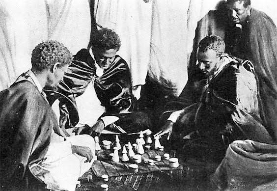

# Senterej

*Also known as: Sant'raj · Shatranj-like · Ethiopian chess*

**Encyclopedia ID 707** (permanent) · https://bpupadhyaya.github.io/world-heritage-games-site/games/707-senterej/

*Photo: BeteAmora, [CC BY-SA 4.0](https://creativecommons.org/licenses/by-sa/4.0/), [source on Wikimedia Commons](https://commons.wikimedia.org/wiki/File:Ethiopian_nobles_chess.jpg)*

Regional chess variant whose opening lets each side make free moves until the first capture.

## Heritage note

Part of the living heritage of Ethiopia, Eritrea.

## Origins

Usually placed in the era of Crossroads and Golden Ages (about 500 to 1500), although its exact origins are uncertain, within the cultural world of Africa: Nile and the Horn.

## Facts

- **Where:** Ethiopia, Eritrea
- **Type:** Board and table games
- **Family:** Chess family
- **Era:** [Crossroads and Golden Ages](../../eras/crossroads/index.md) (uncertain)
- **Cradle:** [Africa: Nile and the Horn](../../cradles/africa-nile/index.md)
- **Region:** Sub-Saharan Africa
- **Players:** 2

## Related entries

- [Chaturanga](../../games/45-chaturanga/index.md)
- [Sittuyin](../../games/302-sittuyin/index.md)
- [Chess](../../games/552-chess/index.md)
- [Luzhanqi](../../games/640-luzhanqi/index.md)
- [Hasami shogi](../../games/849-hasami-shogi/index.md)
- [Shogi](../../games/852-shogi/index.md)

## Sources

- <https://en.wikipedia.org/wiki/Senterej>
